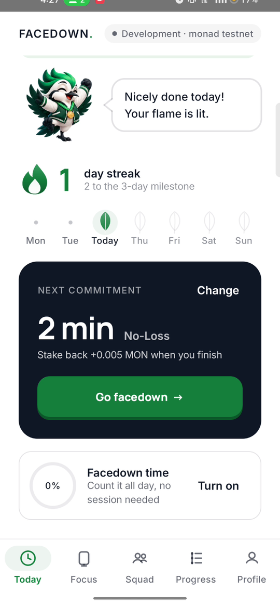
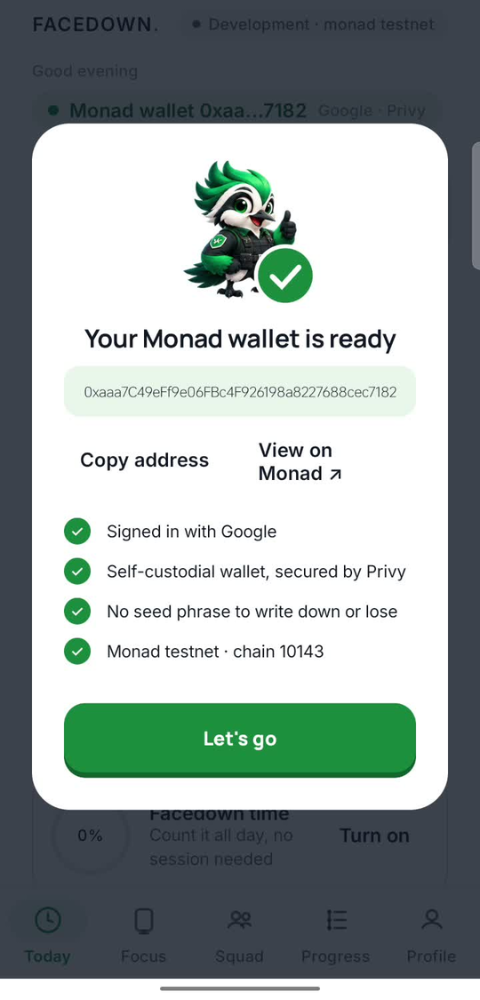
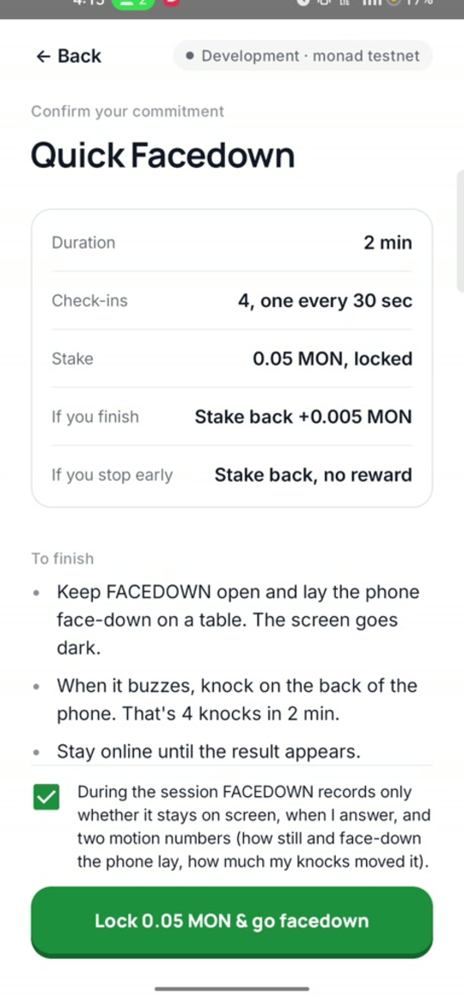
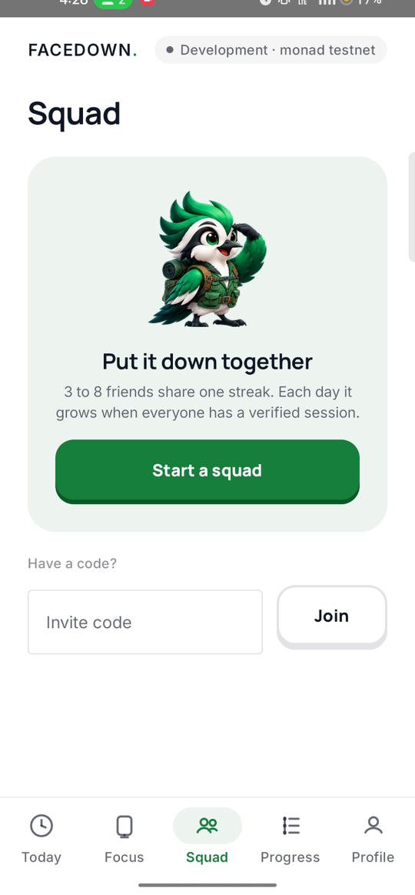
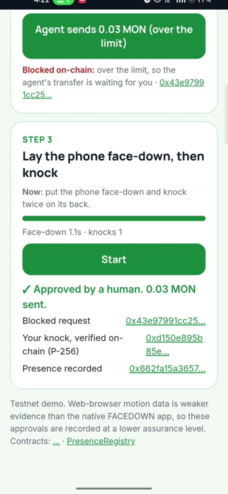
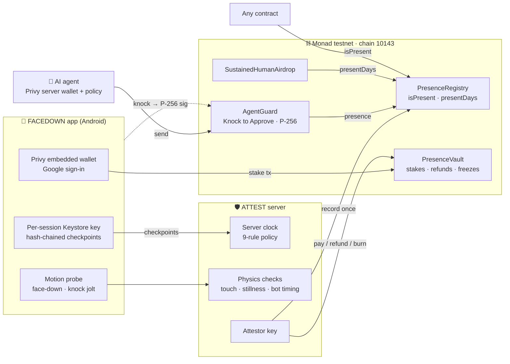
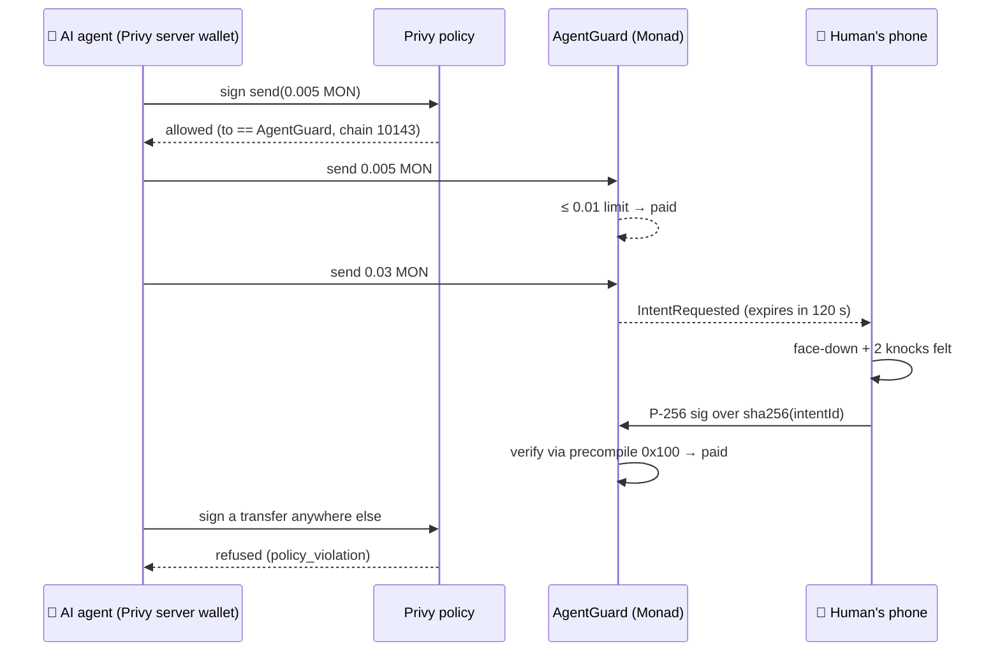
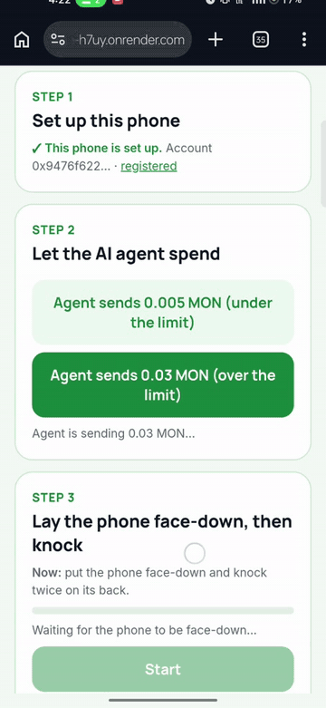

<p align="center"></p>

<p align="center">
  <a href="https://youtu.be/XANOR8fdU4E"><b>▶ Demo film</b></a> ·
  <a href="#try-it-in-60-seconds"><b>Try it</b></a> ·
  <a href="#knock-to-approve-a-human-in-the-loop-for-ai-agents"><b>Knock to Approve</b></a> ·
  <a href="#privy-beyond-login"><b>Privy</b></a> ·
  <a href="#why-monad"><b>Why Monad</b></a> ·
  <a href="#architecture"><b>Architecture</b></a> ·
  <a href="docs/whitepaper/presence_whitepaper.pdf"><b>Whitepaper</b></a> ·
  <a href="#run-it"><b>Run it</b></a>
</p>

<p align="center">
  
  
  
  
  
  
</p>

> **AI agents can now operate phones.** They tap, type and approve, so anything that only checks for taps (an airdrop,
> a quest, a reward, a payment approval) can be farmed. **PRESENCE** proves that a real person *physically* did a
> process on a real device and records it once on **Monad**, where any contract can check it in one line.
> **FACEDOWN** is the first app built on it: commit to a session, lay the phone face-down, knock on its back when it
> buzzes. **Knock to Approve** puts the same proof in front of an AI agent's big payments.

<table><tr>
<td width="150" align="center"></td>
<td>

**Hi, I'm Pip.** I live inside FACEDOWN: I count down with you, I check every knock is a real person, and I celebrate
when the server verifies your session. The short version: **phones are built to be picked up, and nothing holds you
to the promise you made yourself. We built the thing that does, made it provable on Monad, and gave AI agents a
human to answer to.**

</td></tr></table>

## At a glance

| | |
|---|---|
| **Hackathon** | Monad Metropolis · primary track **Trust, Identity & AI Infrastructure** · sponsor bounty **Privy** (beyond login) |
| **What's live** | 5 contracts on Monad testnet (chain 10143), all source-verified on Sourcify · ATTEST server at [presence-h7uy.onrender.com](https://presence-h7uy.onrender.com) · Android app [`releases/presence-monad.apk`](releases/presence-monad.apk) |
| **Proven on a real phone** | Google sign-in via Privy → embedded Monad wallet signs a 0.05 MON No-Loss stake in-app → 4 physical knocks → verified → recorded on Monad → stake back + bonus. Knock to Approve with a real knock: P-256 signature verified by the contract. |
| **Tests** | 10 Foundry contract tests (incl. real P-256 signatures) · 59 server tests · 10 Android unit tests |
| **Watch** | [Demo film (3 min)](https://youtu.be/XANOR8fdU4E) |

## Try it in 60 seconds

**No install, any Android phone:** open **[presence-h7uy.onrender.com/agent](https://presence-h7uy.onrender.com/agent)** in
Chrome (the free server may take ~30 s to wake).

1. **Set up this phone.** The browser makes a P-256 key that never leaves the device and binds it to `AgentGuard`.
2. **Agent sends 0.005 MON.** Under the 0.01 limit: it goes through with no human.
3. **Agent sends 0.03 MON.** Over the limit: **held on-chain**, waiting for you.
4. **Tap Start, lay the phone face-down, knock twice on its back.** The phone signs that exact transfer and `AgentGuard`
   verifies the signature itself through Monad's P-256 precompile (`0x100`, RIP-7212). You get three explorer links:
   the held request, your verified knock, and the presence record.

**The full app:** install [`presence-monad.apk`](https://github.com/notwen123/PRESENCE/raw/main/releases/presence-monad.apk)
→ *Continue with Google* (Privy creates your Monad wallet) → pick 2 min, Free or No-Loss → face-down → knock when it buzzes.

<p align="center">







<br><sub>Real app on a realme phone, Monad testnet, 14 Oct 2026: Today · Privy wallet ready · Confirm · Face-down timer ·
Receipt (recorded on Monad) · Progress · Squad · Knock to Approve. Development mode (device attestation bypassed and
labelled); testnet MON has no value.</sub>
</p>

## Architecture



**The client collects, ATTEST decides, Monad records.** The app never sends "verified" or "reward". The server times
every session on its own clock, re-derives a SHA-256 evidence chain signed by a per-session Android Keystore key, and
checks that every check-in was a physical knock the accelerometer felt. Only then does it write one record to
`PresenceRegistry` and settle the stake through `PresenceVault`. Identities and missions go on-chain only as SHA-256
hashes; raw sensor data never leaves the phone. Details: [architecture](docs/architecture.md) ·
[evidence model](docs/evidence-model.md) · [trust model](docs/trust-model.md) · [security](docs/security.md).

## PRESENCE on Monad: proof of a human, for contracts and AI agents

Contracts can ask two questions:

- **Is a human here now?** `isPresent(identity, minAssurance, maxAgeDays)`
- **Does a human keep showing up?** `presentDays(identity, fromDay, toDay)`: distinct UTC days verified present.
  Proof of personhood checks a human once; this makes a farm's cost grow with identities × days (the
  bounded-participation argument in [arXiv 2609.35300](https://arxiv.org/abs/2609.35300)).
  [`SustainedHumanAirdrop`](contracts/src/SustainedHumanAirdrop.sol) pays only identities present on several days.

### Add it to your contract: one line

```solidity
interface IPresence {
    function isPresent(bytes32 identity, uint8 minAssurance, uint32 maxAgeDays) external view returns (bool);
    function presentDays(bytes32 identity, int64 fromDay, int64 toDay) external view returns (uint256);
}

// only people who were really here in the last day
require(IPresence(0x5519dacface816519ACa3ee3cD592fd4c61dE52B).isPresent(id, 2, 1), "human presence required");
```

Integration guide (Solidity + viem): [docs/integration.md](docs/integration.md).

## Knock to Approve: a human in the loop for AI agents



[`AgentGuard`](contracts/src/AgentGuard.sol) holds an agent's budget. The agent spends small amounts alone; anything
above its limit becomes a pending intent that only its human can release **by physically knocking on their phone**.
The phone signs `sha256(intentId)` with a P-256 key (WebCrypto in any phone browser; the same curve as Android
Keystore and passkeys), and the contract verifies it with Monad's P-256 precompile. The server relays the transaction
but **cannot forge an approval**: without the phone's key, the contract reverts. Each signature is bound to one intent
(contract, chain, account, recipient, amount, nonce) and expires in 120 s.

<p align="center"></p>

## Privy, beyond login

| | How we use Privy | Where |
|---|---|---|
| **Users** | *Continue with Google* creates a self-custodial **embedded Monad wallet** (no seed phrase, no wallet app). It `personal_sign`s each session's sign-in message and **signs the stake and streak-freeze transactions** (`eth_signTransaction`) inside the app; the app broadcasts them to Monad. | [`WalletRepository.kt`](app/src/main/java/com/presence/wallet/WalletRepository.kt) (Privy Android SDK 0.16) |
| **AI agent** | The agent's wallet is a **Privy server wallet** with a **Privy policy** that allows `eth_signTransaction` only to `AgentGuard` on chain 10143. Anything else is refused by Privy (`policy_violation`, tested). Privy limits *where* the agent can send; `AgentGuard` limits *how much* it can send without its human. | [`agent.py`](backend/attest/agent.py) (`PrivySender`) |

## Live on Monad testnet

All contracts are source-verified on Sourcify. Every address and hash: [`contracts/deployments/monad-testnet.json`](contracts/deployments/monad-testnet.json).

| Contract | Address | Role |
|---|---|---|
| `PresenceRegistry` | [`0x5519dacf…E52B`](https://testnet.monadvision.com/address/0x5519dacface816519ACa3ee3cD592fd4c61dE52B) | One record per verified session · `isPresent` · `presentDays` |
| `PresenceVault` | [`0xfC157D4b…163B`](https://testnet.monadvision.com/address/0xfC157D4b8D9573413a3A793056D7625eD972163B) | Stakes, No-Loss refunds, sponsor rewards, freeze burns |
| `AgentGuard` | [`0xdC3Ba526…1B11`](https://testnet.monadvision.com/address/0xdC3Ba526FF565D0c76131D54a30aFA3c55041B11) | Knock to Approve (agent limit 0.01 MON; agent = Privy server wallet `0x55215B31…2271`) |
| `SustainedHumanAirdrop` | [`0x62CbaaAc…64d1`](https://testnet.monadvision.com/address/0x62CbaaAc53ef415fE0262E41e3ce4C2B9af164d1) | Pays only after 3 present days in 30 |
| `HumanGatedVault` | [`0x2AF710af…f6b4`](https://testnet.monadvision.com/address/0x2AF710af85914DEe0AA89017223638367645f6b4) | First demo: agent withdrawals need fresh presence |

**Proof, step by step (real transactions):**

| | Transaction |
|---|---|
| **Real phone, Google sign-in via Privy, No-Loss**: embedded wallet signed the session and the 0.05 MON stake in-app; 4 knocks; stake back + 0.005 MON | [`0xe7f5a415…4850`](https://testnet.monadvision.com/tx/0xe7f5a4159312f0acce7768479d0fe0cad9cece2db374c77c5faf7c71f38b4850) |
| **Real phone, Google sign-in via Privy, Free**: 4 knocks, 0.005 MON sponsor reward | [`0x6e8abfc8…3ee1`](https://testnet.monadvision.com/tx/0x6e8abfc84566f1026fb800c37d93a1e87362cd85e866ddf0d0786e3b0ad63ee1) |
| **Knock to Approve on a real phone** (Chrome, no install): agent's 0.03 MON held → face-down, two knocks → P-256 verified on-chain, sent → presence recorded | [`0x43e97991…30fc`](https://testnet.monadvision.com/tx/0x43e97991cc252267a32d5cb8cad21b497b74bbb14f714c4556bd619b496c30fc) → [`0xd150e895…b533`](https://testnet.monadvision.com/tx/0xd150e895b85e060228b06d7388b84192116b502eea9fa78fb90e2c3bd943b533) → [`0x662fa15a…ef5e`](https://testnet.monadvision.com/tx/0x662fa15a36578254e790d962566e406e9c2289802ba70640dcefae6d76f6ef5e) |
| ① Phone key bound to the agent's account | [`0x41bd309d…0439`](https://testnet.monadvision.com/tx/0x41bd309df3eb8168f0ec604d5bb3551fe68e4732572fd06ad32c73f713d80439) |
| ② Agent (signed by Privy) sends 0.005 MON: no approval needed | [`0xaa726c9c…ff84`](https://testnet.monadvision.com/tx/0xaa726c9cdf881b438c162ef28fe3055a7865a3bf6034b26d426209ac8aa3ff84) |
| ③ Agent sends 0.03 MON: held on-chain (`IntentRequested`) | [`0xa33e7f59…3e59`](https://testnet.monadvision.com/tx/0xa33e7f59a14f99c57a6f6f7a7c49a9bf4e4a7b89c41466e4bf09f9b92b683e59) |
| ③b Agent tries to sign a transfer to any other address | refused by Privy (`policy_violation`), never reaches the chain |
| ④ A forged signature | reverted by the contract (reproduce: [`backend/scripts/knock_e2e.py`](backend/scripts/knock_e2e.py)) |
| ⑤ The knock's P-256 signature verified on-chain, 0.03 MON sent | [`0x0881af9d…f9b2`](https://testnet.monadvision.com/tx/0x0881af9d492b67d1edf291bb93bffb2130ff1f2f36eb7f0c5dcde2e6c4a8f9b2) |
| ⑥ The knock recorded as presence | [`0x3dcaa0a3…0365`](https://testnet.monadvision.com/tx/0x3dcaa0a3185f0a0941aa4d638a58afdf8f3a938fd2753b501adef71f253d0365) |

## Why Monad

PRESENCE needs a chain where a proof of presence is cheap to write, final fast enough to sit in the loop of an agent's
next action, and readable by **any** contract. Measured on Monad testnet:

| Measured | Result |
|---|---|
| Recording one verified session (`record()`) | **1 transaction, 128,512 gas limit ≈ 0.0131 MON** at 102 gwei, about **$0.0003** (MON $0.0244, 14 Oct 2026) |
| Block time, averaged over 1,000 blocks | **0.304 s** |
| P-256 signature check | native precompile at `0x100` (RIP-7212): the phone's signature is verified **by the contract**, not by our server |

- **Composable by default.** It's the EVM: any wallet, vault, quest or agent framework calls `isPresent()` with no SDK.
- **Fast enough to sit in the loop.** Sub-second blocks mean a presence proof can gate an agent's next action, not a
  batch job hours later.
- **Agents live here.** Embedded and agent wallets on Monad (Privy and others) are exactly the accounts that need a
  "was a human actually here?" check before high-value actions.
- **Cheap enough to record every session.** At ~$0.0003 a record, the chain bill doesn't decide the business model.

## FACEDOWN in four moments

<table>
<tr>
<td width="50%" valign="top">

**① Sign in, commit.** *Continue with Google*: Privy creates your Monad wallet. Pick 2, 10, 25 or 60 minutes and
Free, No-Loss or Stake. The exact terms are on screen before anything is signed; the wallet signs in the app.


</td>
<td width="50%" valign="top">

**② Put it face-down, knock when it buzzes.** The screen goes dark. Check-ins come at unpredictable moments; a knock
on the back answers without picking the phone up.


</td>
</tr>
<tr>
<td valign="top">

**③ The server verifies, the flame lights.** Server-timed duration, every hash in the evidence chain, human touch and
phone-down. Then the session is recorded on Monad and the stake comes back with a bonus.


</td>
<td valign="top">

**④ Bring friends.** A squad of 3–8 shares one streak that only grows on days everyone shows up. Reach for a
distracting app and the Urge Catcher asks first.


</td>
</tr>
</table>

| | Feature | How |
|---|---|---|
| ⏱️ | **Commit** | 2, 10, 25 min or a Facedown Hour. **Free** (a sponsor pays a small reward), **No-Loss** (lock MON, always get it back, finishers earn a bonus) or **Stake** (finish for your stake back + up to 20%). |
| 📱 | **Put it face-down** | The screen goes black. The phone buzzes at moments you can't predict; **knock on the back** to answer. One missed knock is forgiven. |
| 🧪 | **Prove it** | The accelerometer proves the phone lay face-down and still and that every answer was a physical knock, not input injected by a script or AI agent. The server times everything. |
| ⛓️ | **Recorded on Monad** | Each verified session is recorded once in `PresenceRegistry`; the stake settles through `PresenceVault`. |
| 🔒 | **Cool-down Lock** | Quit a Stake session and your stake is **locked for 7 days** (then 14, 30 for repeat quits), then it comes back. Never lost, never given to anyone else. |
| 🛑 | **Urge Catcher** | Open Instagram, YouTube or X and FACEDOWN pauses first: *go facedown 10 min instead?* |
| 🟢 | **Presence Minutes** | Whenever the phone lies face-down and still, a ring fills toward a 3-hour daily goal, without opening the app. |
| 👥 | **Squads & streak freezes** | 3–8 friends share one streak. A **streak freeze** (0.02 MON, half burned on-chain) covers one missed day. |

## Can't you just cheat?

<table><tr>
<td width="150" align="center"></td>
<td>

**Pip, on guard duty:** "Try it. Here's what happens."

</td></tr></table>

| Attempt | Why it fails |
|---|---|
| Fake the timer / fast-forward | The **server** times the session from its own clock. Checkpoints that arrive early are rejected. |
| Use the phone during the session | Leaving the app is recorded in every checkpoint and fails the session. Picking the phone up breaks face-down stillness. |
| Let a script or an AI phone agent answer | Answers must be knocks the accelerometer feels. Injected input moves nothing: production rejects it (`AUTOMATION_DETECTED`). **Measured below.** |
| Replay or forge evidence | Checkpoints form a SHA-256 hash chain signed by a per-session Android Keystore key bound into the wallet's sign-in. |
| Farm sponsor rewards with many wallets | One claim per identity per mission per day and a daily reward cap per identity (0.1 MON on testnet). Today the identity is the wallet (development mode); binding it to one physical device is the production design. |
| Swap the stake transaction | ATTEST accepts a stake only if the `Staked` event matches the issued reference, sender and exact amount. |
| Record the same session twice | `PresenceRegistry.record()` reverts with `AlreadyAttested` for a repeated (identity, mission, day, claim index). |
| Have the server approve an agent payment | `AgentGuard` checks the phone's P-256 signature itself; without the phone's key it reverts. |
| Let a compromised agent move a big amount | Its Privy policy only allows calls to `AgentGuard`, and `AgentGuard` holds any single transfer over 0.01 MON for a knock. (The limit is per transfer, not yet a daily budget: see limitations.) |

### Measured: physics catches scripts

<table><tr>
<td width="50%"></td>
<td width="50%" valign="top">

**Scripts get caught by physics, not by timing.** Script-driven taps on a real phone read 20–115 mm/s² (median 35.5)
against a 150 mm/s² floor; **29 of 30** fell below it, even though their answer *timing* looked human. **And we say
where it breaks:** a device that fakes its own sensors (an emulator, or a privileged system-level agent, see
[ActReal, arXiv 2608.30038](https://arxiv.org/abs/2608.30038)) passes today. Hardware key attestation is the fix.

</td></tr></table>

## How it compares

| | Proves a unique human | Proves a human is **here, now** | Keeps proving it **every day** | Agent can't fake it with taps | Extra hardware |
|---|---|---|---|---|---|
| CAPTCHA | no | weakly, once | no | no (agents solve them) | none |
| World ID | **yes** (iris, once) | no | no | n/a | Orb |
| Passkeys / device attestation | no | a device, not a body | no | no (taps a button) | none |
| **PRESENCE** | no (one per device) | **yes**: physical knocks, server-timed | **yes**: `presentDays` | **yes**: needs a face-down phone and a knock | none (the phone) |

PRESENCE complements proof of personhood: World ID says *who is unique*; PRESENCE says *a body was at this device just
now, and keeps showing up*. A web-browser knock is weaker evidence than the native app, so `/agent` records at
assurance 1 and the FACEDOWN app at 2.

## The problem

<table><tr>
<td width="55%" valign="top">

**Agents can tap. They can't physically be there.**

- **AI agents can now operate a phone.** They tap, type and approve, so any reward, quest or airdrop that only checks
  for taps can be farmed by a bot ([Liu & Huang, arXiv 2609.02154](https://arxiv.org/abs/2609.02154)).
- **Wallets are free; devices aren't.** One farmer can run thousands of wallets, but each needs a real phone lying
  face-down to pass a physical check, and PRESENCE caps claims and rewards per device.
- **Focus tools can't be checked either.** Blockers are one tap from off, timers run on your own phone, and commitment
  apps need a referee or take your money. Nothing real can ride on them.

**The missing piece: proof that a person physically did the process, cheap enough to settle on-chain.** FACEDOWN is
how that proof gets made every day: a habit people want, that produces verified human sessions.

</td>
<td width="45%"></td>
</tr></table>

## The research behind it

<table><tr>
<td width="45%"></td>
<td width="55%" valign="top">

| | Finding | Source |
|---|---|---|
| **91%** | of people improved attention, mental health or well-being after 2 weeks without mobile internet (RCT) | Castelo et al., [PNAS Nexus 2025](https://doi.org/10.1093/pnasnexus/pgaf017) |
| **26 min/day** | more phone time cut when people **chose their own** goal (73% larger; RCT, N = 149) | Sachdeva et al., [Soc Sci Med 2026](https://doi.org/10.1016/j.socscimed.2026.119683) |
| **57%** | fewer openings of target apps with a short pause first | Grüning et al., [PNAS 2023](https://doi.org/10.1073/pnas.2213114120) |
| **90% vs 13.7%** | accepted reward programs vs deposit programs (n = 2,538) | Halpern et al., [NEJM 2015](https://doi.org/10.1056/NEJMoa1414293) |
| **2×** | appointments more than doubled uptake vs financial commitment devices | Derksen et al., [arXiv 2110.06876](https://arxiv.org/abs/2110.06876) |
| **+3.2 kg** | group-pooled incentives beat individual ones | Kullgren et al., [Ann Intern Med 2013](https://doi.org/10.7326/0003-4819-158-7-201304020-00002) |
| **98.4%** | accuracy of a motion signal at telling humans from AI-agent-driven logins (table-top) | Liu & Huang, [arXiv 2609.02154](https://arxiv.org/abs/2609.02154) |

</td></tr></table>

<table><tr>
<td width="150" align="center"></td>
<td>

**Pip, reading the papers:** "**Rewards first**, because almost nobody signs up to lose money (Halpern). **Daily
appointments**, because they beat penalties (Derksen). **You pick the length**, because self-chosen goals work 73%
better (Sachdeva). **A pause before the app opens** (Grüning). **Squads**, because groups pull harder (Kullgren). And
**no new token**: rewards come from sponsor pools, never emissions."

</td></tr></table>

## Business

| Who pays | For what | Status |
|---|---|---|
| **Quest & airdrop teams** | Bot-resistant distribution, priced per verified human-day, checked with `isPresent()` / `presentDays()` | Contracts built; no customer yet |
| **Employers, schools, parents** | Sponsor pools that pay out only for verified focus sessions | Sponsor pools built (PresenceVault) |
| **Wallets & AI-agent apps** | Knock to Approve before high-value agent payments | Testnet demo built (AgentGuard) |
| **FACEDOWN users** | Streak freezes (half burned on-chain); later a Pro tier | Freezes built |

**Users' stakes are never revenue**: No-Loss stakes always come back; Stake mode locks, never confiscates.
**Economic security:** farming one device pays only if *daily cap × days > device cost*, so a small per-device cap makes
phone farms uneconomic while a real person never notices it. No customers have signed yet; these are the buyers we
test first. **Go-to-market:** friend and campus squads first (the invite code is the referral loop), then Monad
ecosystem quests where "complete a verified FACEDOWN session" is a task bots can't farm.

## Honest limitations

- **One attestor today.** ATTEST signs every record; `PresenceRegistry` supports several attestors (`setAttestor`), and
  a quorum of independent attestors is the next step ([trust model](docs/trust-model.md)).
- **Sensors can be faked by a privileged agent** ([ActReal](https://arxiv.org/abs/2608.30038)): motion evidence is a
  strong signal, not proof, until hardware key attestation is required.
- **Development mode:** device attestation is bypassed and labelled on every receipt, and the identity is the wallet, so one person with many wallets is not yet limited to one device.
- **AgentGuard's limit is per transfer, not a budget.** A compromised agent could still send many small (≤ 0.01 MON) transfers; a rolling daily budget is the next contract change.
- **PresenceVault trusts the attestor.** "Stakes always come back" is enforced by ATTEST's rules, not by the vault contract itself.
- **Record and payout are two transactions.** A crash between them leaves a session recorded but unpaid; a retry can't pay twice (`AlreadyAttested`).
- **Real knocks across many phone models are not yet measured**; the 150 mm/s² floor is a design value.
- **Testnet only**; testnet MON has no value. No users beyond our own testing, no revenue, no funding.

## Roadmap (designed, not built)

- **Hardware attestation:** Android Key Attestation / Play Integrity for the session key, so a phone that lies about
  its sensors is refused. Closes the biggest gap we measured.
- **Guardian quorum:** several independent attestors re-checking the same deterministic evidence.
- **Monad mainnet**, after a security audit.
- **Agent budgets:** a rolling daily spend limit in `AgentGuard`, on top of the per-transfer limit.
- **Agent SDK:** drop-in Knock to Approve for agent frameworks and wallets.
- **Presence Model:** an on-device classifier trained on real, opt-in session traces to replace hand-tuned thresholds.
- **Yield-funded No-Loss:** locked stakes earn yield that funds finisher bonuses instead of sponsors.

## Repository map

| Path | What |
|---|---|
| [`contracts/`](contracts) | Solidity (Foundry): `PresenceRegistry`, `PresenceVault`, `AgentGuard`, `SustainedHumanAirdrop`, `HumanGatedVault`, tests, deployments |
| [`backend/attest/`](backend/attest) | ATTEST server (Python/FastAPI): sessions, evidence chain, policy, Monad settlement, Privy agent, `/agent` and `/monad` pages |
| [`app/`](app) | FACEDOWN Android app (Kotlin/Compose): Privy wallet, motion probe, evidence chain, Pip |
| [`docs/`](docs) | Architecture, evidence model, trust model, security, integration, mission policy, demo script, whitepaper |
| [`releases/presence-monad.apk`](releases/presence-monad.apk) | Signed Android build (Google sign-in via Privy, live server) |
| [`legacy/solana/`](legacy/solana) | The earlier Solana prototype, archived; not part of the Monad system |

## Run it

```bash
cd contracts && forge test                      # 10 tests: registry, presentDays, vault, AgentGuard with real P-256 sigs
cd backend && uv run pytest -q                  # 59 tests: protocol, policy, physical evidence, caps, Monad, SIWE
# ATTEST on Monad (keys from your own .env.local, never committed):
MONAD_REGISTRY=0x5519dacface816519ACa3ee3cD592fd4c61dE52B MONAD_VAULT=0xfC157D4b8D9573413a3A793056D7625eD972163B \
MONAD_ATTESTOR_KEY=0x... ATTEST_DEV_MODE=true ATTEST_MISSIONS=backend/missions_monad.json \
  uv run --project backend python -m attest.app          # then open http://127.0.0.1:8787/monad
# Knock to Approve: add AGENT_GUARD=0xdC3Ba526FF565D0c76131D54a30aFA3c55041B11 and either
#   PRIVY_AGENT_WALLET + PRIVY_APP_ID + PRIVY_APP_SECRET (agent = Privy server wallet) or AGENT_KEY; then open /agent
ATTEST_URL=http://127.0.0.1:8787 uv run --project backend python backend/scripts/knock_e2e.py   # end-to-end check
# Android: ./gradlew :app:assembleRelease -Ppresence.backendUrl=... -Ppresence.privyAppId=... -Ppresence.privyClientId=...
```

## Credits

- **Film:** stock footage from [Pexels](https://www.pexels.com) (Pexels License); music "Deep Urban" and "Tech House
  Vibes" ([Mixkit](https://mixkit.co) licence); voice by Kokoro-82M TTS (Apache-2.0). Every app screen is the real app.
- **Fonts:** Manrope and Inter (SIL OFL).
- **AI tools:** Claude Code (Anthropic) wrote much of the code, tests, docs, whitepaper and films under the team's
  direction and review.

## Team WARRIO

- **Aaditya** (iocryp15), lead · [@Aaditya1273](https://github.com/Aaditya1273)
- **arpit_1**, co-founder · [@lsuDOKO](https://github.com/lsuDOKO)

<table><tr>
<td width="150" align="center"></td>
<td>

**Pip, signing off:** "Put it down. Show up. Start with 2 minutes."

</td></tr></table>
