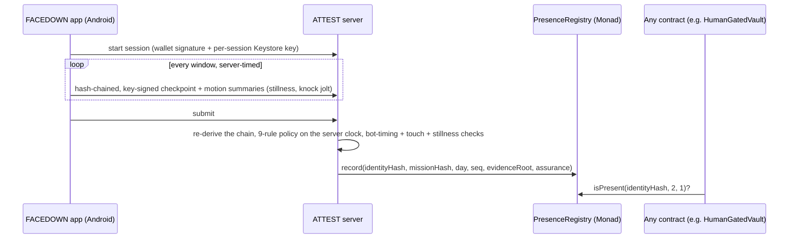

<p align="center"></p>

<p align="center">
  <a href="docs/whitepaper/presence_whitepaper.pdf"><b>Whitepaper</b></a> ·
  <a href="#monad-metropolis-submission"><b>Monad submission</b></a> ·
  <a href="#presence-on-monad-proof-of-a-human-for-contracts-and-ai-agents"><b>Live on Monad</b></a> ·
  <a href="#why-monad"><b>Why Monad</b></a> ·
  <a href="#how-it-works"><b>How it works</b></a> ·
  <a href="#run-it"><b>Run it</b></a>
</p>

<p align="center">
  
  
  
  
  
</p>

**AI agents can now operate phones, so any reward that checks for taps can be farmed.** **PRESENCE** proves that a
real person physically did a process on a real device, and records it once on **Monad**, where any contract can check
it with `isPresent()`. The session is timed by our server, every check-in must be a physical knock the accelerometer
feels, and claims are bound to one device. **FACEDOWN** is the first app built on it: book a session, lay the phone
face-down, knock on its back when it buzzes, and the verified session lands in `PresenceRegistry` on Monad.

<table><tr>
<td width="150" align="center"></td>
<td>

**Hi, I'm Pip.** I live inside FACEDOWN: I'm on the launch screen, I count down with you, and I celebrate when the
server verifies your session. I'll walk you through this page. The short version: **phones are built to be picked up,
and nothing holds you to the promise you made yourself. We built the thing that does, and we made it provable.**

</td></tr></table>

## Monad Metropolis submission

| | |
|---|---|
| **Primary track** | **Trust, Identity & AI Infrastructure**: a protocol-level primitive for trust and provenance in the AI-agent era. PRESENCE proves a real person physically did a process on a real device, and any Monad contract can check it with `isPresent()`. |
| **Built during the hackathon** | `PresenceRegistry` and `HumanGatedVault` (Solidity, Foundry, 5 tests), the ATTEST server's Monad anchoring (3 tests), the live verifier page (`/monad`) and the testnet demo below. FACEDOWN's app and verification engine are the existing context we built on. |
| **Sponsor bounties** | None claimed yet. We list a bounty here only once its integration is built and demoable. |

## PRESENCE on Monad: proof of a human, for contracts and AI agents

**Monad Metropolis · Trust, Identity & AI Infrastructure.** PRESENCE verifies a real person's physical session
off-chain (server-timed, hash-chained, physical knock check-ins) and records the verdict **once** in
[`PresenceRegistry`](contracts/src/PresenceRegistry.sol) on Monad. Any contract can then ask
`isPresent(identity, minAssurance, maxAgeDays)`. Identities and missions go on-chain only as SHA-256 hashes.

[`HumanGatedVault`](contracts/src/HumanGatedVault.sol) shows why that matters in the agent era: an AI agent's key can
move small amounts alone, but **any withdrawal above its limit needs a fresh proof that its human was physically
present**. Taps, scripts and agents can't produce that proof.

**Live on Monad testnet (chain 10143), both contracts source-verified (Sourcify exact match):**

| | |
|---|---|
| `PresenceRegistry` | [`0x1d13EAC5bADfA35eB2767f10A50C27CF54d7F179`](https://testnet.monadvision.com/address/0x1d13EAC5bADfA35eB2767f10A50C27CF54d7F179) |
| `HumanGatedVault` | [`0x2AF710af85914DEe0AA89017223638367645f6b4`](https://testnet.monadvision.com/address/0x2AF710af85914DEe0AA89017223638367645f6b4) (agent limit 0.01 MON) |
| ① Agent withdraws 0.03 MON, no presence proof: **blocked** (`HumanPresenceRequired`) | [`0xe257dd0b…70dc`](https://testnet.monadvision.com/tx/0xe257dd0baf4eacc1ea37ef191e27f8a75d3f4d548d23e83275977d06961970dc) |
| ② A real 2-minute FACEDOWN session is verified by ATTEST and recorded | [`0xa0466d10…8e52`](https://testnet.monadvision.com/tx/0xa0466d10fb58ae4c9fcfbc52360f234bf0b99c49fde663b2e31991fa85348e52) |
| ③ Same agent, same 0.03 MON: **allowed** | [`0x1d1befe4…3bf4`](https://testnet.monadvision.com/tx/0x1d1befe4e297cfef6b0924e3be01f7ac998f0f33dd6117929f53a4868d873bf4) |

All addresses and hashes: [`contracts/deployments/monad-testnet.json`](contracts/deployments/monad-testnet.json).
Reproduce: `cd contracts && forge test` (5 tests), then [`scripts/monad_demo.py`](scripts/monad_demo.py) against an
ATTEST server started with `MONAD_REGISTRY` and `MONAD_ATTESTOR_KEY`. The session in ② ran through the reference client (the
same protocol the app speaks), in development mode. A live verifier page is served by ATTEST at `/monad`.

## The problem

<table><tr>
<td width="55%" valign="top">

**Agents can tap. They can't physically be there.**

- **AI agents can now operate a phone.** They tap, type and approve, so any reward, quest or airdrop that only checks
  for taps on a screen can be farmed by a bot ([Liu & Huang, arXiv 2609.02154](https://arxiv.org/abs/2609.02154)).
- **Wallets are free; devices aren't.** One farmer can run thousands of wallets, but each needs a real phone to pass a
  physical check, and PRESENCE caps claims and rewards per device.
- **Focus tools can't be checked either.** Blockers are one tap from off, focus timers run on your own phone, and
  commitment apps need a referee (a friend, a reviewer or an AI looking at photos). Nothing real can ride on them.

**The missing piece: proof that a person physically did the process, cheap enough to pay out on-chain.** FACEDOWN
is how that proof gets made every day: a habit people want, that produces labelled human sessions.

</td>
<td width="45%"></td>
</tr></table>

### Who pays

- **Quest and airdrop issuers** that need bot-resistant distribution: priced per verified
  human-day, checked on-chain through [`verifyPresence()`](docs/integration.md).
- **Employers, schools and parents** funding focus pools: sponsor deposits pay verified sessions (built: sponsor pools,
  on-chain deposit verification).
- **Wallets and agent-payment apps** that want a physical-presence check before a high-value approval. *Hypothesis,
  not built.*

No customers have signed; these are the buyers we will test first.

### Economic security

Every device identity (hashed device identity; the wallet in development mode) can earn at most
`DAILY_REWARD_CAP_PER_DEVICE` in sponsor rewards and bonuses per UTC day; settlement pays `min(reward, cap left today)`.
Stakes are always returned in full and never count against the cap. The design argument, not a measured result:

> farming one device is only profitable if **cap_per_day × days > device_cost**,

so a low per-device daily cap (default 3 test tokens) makes device farms uneconomic, while a real person doing a few
sessions a day never notices it.

## Why Monad

PRESENCE needs a chain where a proof of presence is cheap to write, fast to finalise, and readable by **any** contract,
especially the EVM wallets and agent frameworks that AI agents already use. Measured on Monad testnet, 13 Oct 2026:

| Measured | Result |
|---|---|
| Recording one verified session (`record()`) | **1 transaction, 161,016 gas**, about 0.0164 MON at the testnet gas price of 102 gwei |
| Block time, averaged over 1,000 blocks | **0.304 s** |
| Contracts | `PresenceRegistry` and `HumanGatedVault`, both source-verified (Sourcify exact match) |

- **Composable by default.** It's the EVM, so any wallet, vault, quest or agent framework can call
  `isPresent(identity, minAssurance, maxAgeDays)` with no SDK. `HumanGatedVault` is about 50 lines.
- **Fast enough to sit in the loop.** With sub-second blocks, a presence proof can gate an agent's next action
  instead of a batch job hours later.
- **Agents live here.** Embedded and agent wallets on Monad (Privy, Dynamic, MetaMask Agent Wallet) are exactly the
  accounts that need a "was a human actually here?" check before high-value actions.
- **Privacy.** The registry stores only SHA-256 hashes of the device identity and the mission, plus a 32-byte evidence
  root. Raw sensor data never leaves the phone.

## How it works



- **Client collects, ATTEST decides, Monad records.** The app never sends `verified` or `reward`.
- **Evidence chain.** `checkpoint_i = SHA256("PRESENCE/cp/v3" | prev | payload_i | nonce)`, byte-identical in Kotlin and
  Python (shared golden vectors). Only a 32-byte root goes on-chain.
- **Privacy.** Per window: a foreground flag, an answer count, one answer time and two motion summaries. Raw sensor data
  stays on the phone. On Monad, identities and missions are SHA-256 hashes.
- **Create-once.** `record()` reverts with `AlreadyAttested` for a repeated (identity, mission, day, claim index).
- **Economic security.** A per-device daily reward cap: farming one device pays only if *cap × days > device cost*.

The full maths is in the [whitepaper](docs/whitepaper/presence_whitepaper.pdf).

## Measured: physics catches scripts

<table><tr>
<td width="50%"></td>
<td width="50%" valign="top">

**Scripts get caught by physics, not by timing.** Script-driven taps on a real phone read 20–115 mm/s² (median 35.5)
against a 150 mm/s² floor; their answer *timing* looked human. **And we say where it breaks:** a device that fakes its
own sensors (the emulator's virtual accelerometer, or a privileged system-level agent, see
[ActReal, arXiv 2608.30038](https://arxiv.org/abs/2608.30038)) passes today. Hardware key attestation is the fix.

</td></tr></table>

## What FACEDOWN does

| | Feature | How |
|---|---|---|
| ⏱️ | **Book a session** | A daily time with a reminder, and a length: **2, 10, 25 min or a Facedown Hour**. Pick **Free** (a sponsor pays), **No-Loss** (lock test tokens, always get them back, only finishers earn) or **Stake** (finish for your stake back + up to 20% from sponsors). |
| 📱 | **Put it face-down** | The screen goes black. The phone buzzes a few times at moments you can't predict; **knock on the back** to answer. One missed knock is forgiven. |
| 🧪 | **Prove it** | The accelerometer proves the phone lay face-down and still, and that every answer was a physical knock, not input injected by a script or AI agent. The server times everything on its own clock. |
| ⛓️ | **Get paid on-chain** | Each verified session is recorded once in `PresenceRegistry` on **Monad**; any contract can check it with `isPresent()`. |
| 🔒 | **Cool-down Lock** | Quit a Stake session and your stake is **locked for 7 days** (14, then 30 for repeat quits), then it comes back. Never lost, never given to anyone else. |
| 🛑 | **Urge Catcher** | Open Instagram, YouTube or X and FACEDOWN pauses first: *go facedown 10 min instead?* *Open anyway* unlocks after 10 seconds. |
| 🟢 | **Presence Minutes** | Whenever the phone lies face-down and still, a ring on Today fills toward a 3-hour daily goal, without opening the app. |
| 👥 | **Squads** | 3–8 friends share **one streak** that breaks for everyone if anyone misses a day. A **streak freeze** (paid in tokens, half burned) covers one missed day. |

<p align="center">


<br><sub>Today · Urge Catcher · Confirm · Face-down · Receipt · Progress. Android emulator on <b>devnet</b>, development mode
(device check bypassed and labelled). Rewards are test tokens with no value.</sub>
</p>

## FACEDOWN in four moments

<table>
<tr>
<td width="50%" valign="top">

**① Choose how long, and what's at stake.** 2, 10, 25 or 60 minutes. Free, No-Loss or Stake, with the exact terms
on screen before any wallet prompt. MetaMask signs once.


</td>
<td width="50%" valign="top">

**② Put it face-down, knock when it buzzes.** The screen goes dark. Check-ins come at unpredictable moments; a knock
on the back answers without picking the phone up.


</td>
</tr>
<tr>
<td valign="top">

**③ The server verifies, the flame lights.** Server-timed duration, every hash in the evidence chain, human touch and
phone-down. Then the session is recorded on Monad and the stake comes back with a bonus.


</td>
<td valign="top">

**④ Bring friends, catch the urge.** A squad shares one streak. Reach for a distracting app and FACEDOWN asks first.


</td>
</tr>
</table>

<table><tr>
<td width="150" align="center"></td>
<td>

**Pip, on guard duty:** "People ask me: *can't you just cheat?* Try it. Here's what happens."

</td></tr></table>

| Attempt | Why it fails |
|---|---|
| Fake the timer / fast-forward | The **server** times the session from its own clock. Checkpoints that arrive early are rejected. |
| Use the phone during the session | Leaving the app is recorded in every checkpoint and fails the session. Picking the phone up breaks face-down stillness. |
| Let a script or an AI phone agent answer | Answers are knocks felt by the accelerometer (or a finger tap's jolt). Injected input moves nothing: production rejects it (`AUTOMATION_DETECTED`). **Measured on a real phone below.** |
| Replay or forge evidence | Checkpoints form a SHA-256 hash chain signed by a per-session Android Keystore key bound into the wallet's sign-in. |
| Farm sponsor pools with many wallets | One claim per **device identity** per mission per day, and a per-device daily reward cap. |
| Swap the stake transaction in the wallet | ATTEST submits the stake only if it moves exactly what was issued; wallets may add priority fees, nothing else. |
| Claim the payout twice | Payout and attestation are one transaction on a PDA that can be created once. |
| Record the same session twice | `PresenceRegistry` is create-once per (identity, mission, day, claim index). |
| An AI agent drains its owner's vault | `HumanGatedVault` reverts with `HumanPresenceRequired` above its limit unless the owner was present recently. |

## The research behind it

Every product decision in FACEDOWN comes from a published study. Each number below is quoted from the paper's
abstract; follow the links.

<table><tr>
<td width="45%"></td>
<td width="55%" valign="top">

| | Finding | Source |
|---|---|---|
| **91%** | of people improved attention, mental health or well-being after 2 weeks without mobile internet (RCT) | Castelo et al., [PNAS Nexus 2025](https://doi.org/10.1093/pnasnexus/pgaf017) |
| **26 min/day** | more phone time cut when people **chose their own** goal (73% larger; RCT, N = 149, 12 weeks) | Sachdeva, Somasundaram & Sharma (IIM Udaipur, ISB), [Soc Sci Med 2026](https://doi.org/10.1016/j.socscimed.2026.119683) |
| **57%** | fewer openings of target apps with a short pause first (the *one sec* app) | Grüning, Riedel & Lorenz-Spreen, [PNAS 2023](https://doi.org/10.1073/pnas.2213114120) |
| **90% vs 13.7%** | of people accepted reward programs vs deposit programs (n = 2,538); deposits worked better among those who took them (+13.2 pts) | Halpern et al., [NEJM 2015](https://doi.org/10.1056/NEJMoa1414293) |
| **2×** | Appointments **more than doubled** uptake vs financial commitment devices; most commitment-device takers lost their money | Derksen et al., [arXiv 2110.06876](https://arxiv.org/abs/2110.06876) |
| **+3.2 kg** | Group-pooled incentives beat individual ones for weight loss (95% CI 0.9–5.5) | Kullgren et al., [Ann Intern Med 2013](https://doi.org/10.7326/0003-4819-158-7-201304020-00002) |
| **98.4%** | Accuracy of a motion signal at telling human from AI-agent-driven logins (table-top; 92.6% hand-held; 116 pilot sessions) | Liu & Huang, [arXiv 2609.02154](https://arxiv.org/abs/2609.02154) |
| **9 of 12** | NFT play-to-earn games where trading players lost money on average | Gao et al., [arXiv 2602.13882](https://arxiv.org/abs/2602.13882) |

</td></tr></table>

<table><tr>
<td width="150" align="center"></td>
<td>

**Pip, reading the papers:** "Here's what the research told us to build. **Rewards first**, because almost nobody
signs up to lose money (Halpern). **Daily appointments**, because they beat penalties (Derksen). **You pick the
length**, because self-chosen goals work 73% better (Sachdeva). **A pause before the app opens**, because it halves
openings (Grüning). **Squads**, because groups pull harder (Kullgren). And **no new token**, because emission-funded
games leave players at a loss (Gao)."

</td></tr></table>

## The business

- **Consumer (FACEDOWN):** sponsor-funded Free and No-Loss tiers for reach; streak freezes as a token sink and revenue;
  later a Pro tier and a small rake on opt-in Stake pools (where legal).
- **Infrastructure (PRESENCE):** proof-of-human-process per attestation, sold to airdrop issuers, quest platforms and
  ecosystem campaigns on Monad. "5 verified facedown sessions" is a quest a bot can't farm.
- **Sponsors:** parents funding a student's pool, companies funding employees' focus hours, protocols funding
  campaigns. Sponsor deposits are verified on-chain before they're credited.
- **No new token, no emissions.** Rewards are transfers from sponsor pools, so the economy can't inflate away.

## Roadmap (designed, not built)

- **P4 hardware attestation.** Android Key Attestation for the session key, so a phone that lies about its sensors is
  refused. Closes the biggest gap we measured.
- **Guardian quorum.** Several independent attestors instead of one operator, each re-checking the same evidence
  ([trust-model.md](docs/trust-model.md)).
- **Yield-funded No-Loss.** On mainnet, locked stakes earn yield (e.g. a lending vault on Monad) that funds the
  finisher reward instead of sponsors. Not built: no such vault on devnet to test against.
- **Presence Model.** Replace the hand-tuned knock/stillness thresholds with a small on-device classifier trained on
  real session traces (opt-in). Not built: we don't have the data yet, and a model without data would be theatre.
- **Presence Passport.** A monthly soulbound badge for verified presence that other apps read through `verifyPresence()`.
- **Urge Forecast.** Suggest Facedown Hours from the phone's own usage stats (the hours you lose most).
- **Pledge mode.** Quitting sends the stake to a cause you pick instead of locking it (needs legal review).

<table><tr>
<td width="150" align="center"></td>
<td>

**Pip, being honest:** "Read this before you quote us. We'd rather you hear the limits from us."

</td></tr></table>

## Honest limitations

- **One attestor today.** ATTEST signs every record; `PresenceRegistry` supports several attestors (`setAttestor`), and
  a quorum of independent attestors re-checking the same deterministic evidence is the next step.
- **Sensors can be faked by a privileged agent** ([ActReal](https://arxiv.org/abs/2608.30038)): motion evidence is a
  strong signal, not proof, until hardware key attestation is required.
- **Real knocks across many phones are not yet measured**; the 150 mm/s² floor is a design value.
- **The Android app now signs in with MetaMask** (MetaMask Android SDK, EIP-4361 + `personal_sign`, Monad testnet):
  [`releases/presence-monad-metamask.apk`](releases/presence-monad-metamask.apk). On Monad, missions carry no stake yet.
- **Testnet only**, development mode (device check bypassed and labelled), test tokens with no value. No customers yet.

## Run it

```bash
cd contracts && forge test                      # 5 tests: create-once, attestor auth, streaks, expiry, vault gate
cd backend && uv run pytest -q                  # 54 tests: protocol, policy, physical evidence, caps, Monad anchoring
# ATTEST anchored on Monad (key from your own .env.local, never committed):
MONAD_REGISTRY=0x1d13EAC5bADfA35eB2767f10A50C27CF54d7F179 MONAD_ATTESTOR_KEY=0x... ATTEST_DEV_MODE=true \
  uv run --project backend python -m attest.app          # then open http://127.0.0.1:8787/monad
uv run --project backend python scripts/monad_demo.py session http://127.0.0.1:8787 device.key
```

## Credits

- **Film:** stock footage from [Pexels](https://www.pexels.com) (Pexels License); music "Mountains" by Andrew Ev
  ([Mixkit](https://mixkit.co) licence); voice by Kokoro-82M TTS (Apache-2.0). Every app screen is the real app.
- **Fonts:** Manrope and Inter (SIL OFL).
- **AI tools:** Claude Code (Anthropic) wrote much of the code, tests, docs, whitepaper and film under the team's
  direction and review.

## Team WARRIO

- **Aaditya** (iocryp15), lead · [@Aaditya1273](https://github.com/Aaditya1273)
- **nebula10**

<table><tr>
<td width="150" align="center"></td>
<td>

**Pip, signing off:** "Put it down. Prove it. Start with 2 minutes."

</td></tr></table>
