<p align="center">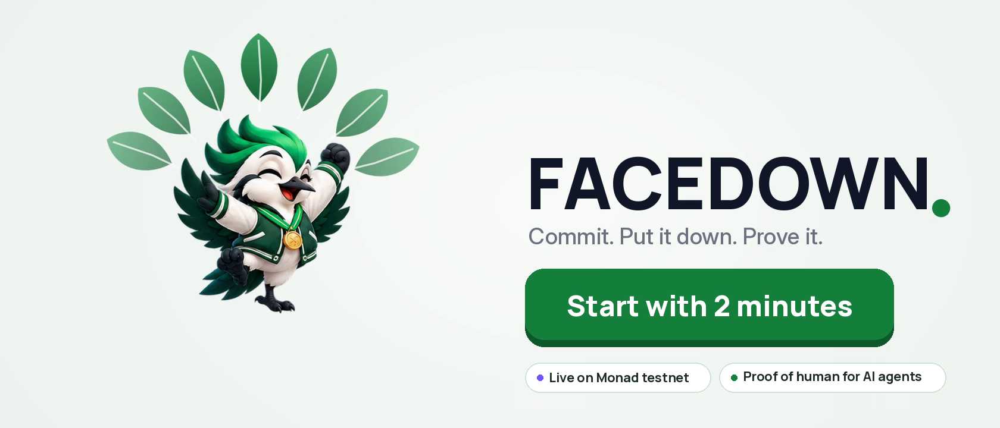</p>

<p align="center">
  <a href="https://youtu.be/TL2G2HT28qY"><b>Film (3 min)</b></a> ·
  <a href="docs/whitepaper/presence_whitepaper.pdf"><b>Whitepaper</b></a> ·
  <a href="#monad-metropolis-submission"><b>Monad submission</b></a> ·
  <a href="#presence-on-monad-proof-of-a-human-for-contracts-and-ai-agents"><b>Live on Monad</b></a> ·
  <a href="#6-why-monad"><b>Why Monad</b></a> ·
  <a href="#8-the-engine-presence"><b>Architecture</b></a> ·
  <a href="#11-run-it"><b>Run it</b></a>
</p>

<p align="center">
  
  
  
  
  
</p>

**AI agents can now operate phones, so any reward that checks for taps can be farmed.** **PRESENCE** proves that a
real person physically did a process on a real device: the session is timed by our server, every check-in must be a
physical knock the accelerometer feels, and claims are bound to one device (the Seeker Genesis Token). It is cheap
enough to attest on-chain: one transaction on **Monad** (161,016 gas, 0.3 s blocks, measured on testnet). **FACEDOWN** is the first consumer
app and the daily-habit engine that generates labelled human sessions: you book a session, lay the phone face-down,
knock on its back when it buzzes; the verified result is recorded in the PRESENCE registry on Monad, and paid out on Solana devnet.

<p align="center">
  <a href="https://youtu.be/TL2G2HT28qY">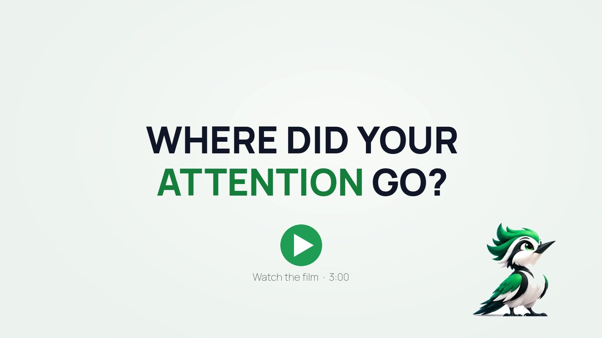</a><br>
  <sub>▶ <b>Watch the 3-minute film.</b> Every app screen in it is the real FACEDOWN app on Solana devnet.</sub>
</p>

<table><tr>
<td width="150" align="center"></td>
<td>

**Hi, I'm Pip.** I live inside FACEDOWN: I'm on the launch screen, I count down with you, and I celebrate when the
server verifies your session. I'll walk you through this page. The short version: **phones are built to be picked up,
and nothing holds you to the promise you made yourself. We built the thing that does, and we made it provable.**

</td></tr></table>

---

## Monad Metropolis submission

| | |
|---|---|
| **Primary track** | **Trust, Identity & AI Infrastructure**: a protocol-level primitive for trust and provenance in the AI-agent era. PRESENCE proves a real person physically did a process on a real device, and any Monad contract can check it with `isPresent()`. |
| **Built during the hackathon** | `PresenceRegistry` and `HumanGatedVault` (Solidity, Foundry, 5 tests), the ATTEST server's Monad anchoring (3 tests), the live verifier page (`/monad`) and the testnet demo below. FACEDOWN's app and verification engine are the existing context we built on. |
| **Sponsor bounties** | None claimed yet. We list a bounty here only once its integration is built and demoable. |

## PRESENCE on Monad: proof of a human, for contracts and AI agents

**Monad Metropolis · Trust, Identity & AI Infrastructure.** PRESENCE verifies a real person's physical session
off-chain (server-timed, hash-chained, physical knock check-ins) and records the verdict **once** in
[`PresenceRegistry`](contracts/src/PresenceRegistry.sol) on Monad. Any contract can then ask
`isPresent(identity, minAssurance, maxAgeDays)`. Identities and missions go on-chain only as SHA-256 hashes.

[`HumanGatedVault`](contracts/src/HumanGatedVault.sol) shows why that matters in the agent era: an AI agent's key can
move small amounts alone, but **any withdrawal above its limit needs a fresh proof that its human was physically
present**. Taps, scripts and agents can't produce that proof.

**Live on Monad testnet (chain 10143), both contracts source-verified (Sourcify exact match):**

| | |
|---|---|
| `PresenceRegistry` | [`0x1d13EAC5bADfA35eB2767f10A50C27CF54d7F179`](https://testnet.monadvision.com/address/0x1d13EAC5bADfA35eB2767f10A50C27CF54d7F179) |
| `HumanGatedVault` | [`0x2AF710af85914DEe0AA89017223638367645f6b4`](https://testnet.monadvision.com/address/0x2AF710af85914DEe0AA89017223638367645f6b4) (agent limit 0.01 MON) |
| ① Agent withdraws 0.03 MON, no presence proof: **blocked** (`HumanPresenceRequired`) | [`0xe257dd0b…70dc`](https://testnet.monadvision.com/tx/0xe257dd0baf4eacc1ea37ef191e27f8a75d3f4d548d23e83275977d06961970dc) |
| ② A real 2-minute FACEDOWN session is verified by ATTEST and recorded | [`0xa0466d10…8e52`](https://testnet.monadvision.com/tx/0xa0466d10fb58ae4c9fcfbc52360f234bf0b99c49fde663b2e31991fa85348e52) |
| ③ Same agent, same 0.03 MON: **allowed** | [`0x1d1befe4…3bf4`](https://testnet.monadvision.com/tx/0x1d1befe4e297cfef6b0924e3be01f7ac998f0f33dd6117929f53a4868d873bf4) |

All addresses and hashes: [`contracts/deployments/monad-testnet.json`](contracts/deployments/monad-testnet.json).
Reproduce: `cd contracts && forge test` (5 tests), then [`scripts/monad_demo.py`](scripts/monad_demo.py) against an
ATTEST server started with `MONAD_REGISTRY` and `MONAD_ATTESTOR_KEY`. Today the FACEDOWN app's wallet and rewards run on
Solana devnet; Monad holds the attestation registry and the agent guard. The session in ② ran through the simulator
client (the same protocol the app speaks), in development mode.

## 1. The problem

<table><tr>
<td width="55%" valign="top">

**Agents can tap. They can't physically be there.**

- **AI agents can now operate a phone.** They tap, type and approve, so any reward, quest or airdrop that only checks
  for taps on a screen can be farmed by a bot ([Liu & Huang, arXiv 2609.02154](https://arxiv.org/abs/2609.02154)).
- **Wallets are free; devices aren't.** One farmer can run thousands of wallets, but each needs a real phone to pass a
  physical check, and PRESENCE caps claims per Seeker Genesis Token.
- **Focus tools can't be checked either.** Blockers are one tap from off, focus timers run on your own phone, and
  commitment apps need a referee (a friend, a reviewer or an AI looking at photos). Nothing real can ride on them.

**The missing piece: proof that a person physically did the process, cheap enough to pay out on-chain.** FACEDOWN
is how that proof gets made every day: a habit people want, that produces labelled human sessions.

</td>
<td width="45%"></td>
</tr></table>

### Who pays

- **Quest issuers and Seeker Season-style campaigns** that need bot-resistant distribution: priced per verified
  human-day, checked on-chain through [`verifyPresence()`](docs/integration.md).
- **Employers, schools and parents** funding focus pools: sponsor deposits pay verified sessions (built: sponsor pools,
  on-chain deposit verification).
- **Wallets and agent-payment apps** that want a physical-presence check before a high-value approval. *Hypothesis,
  not built.*

No customers have signed; these are the buyers we will test first.

### Economic security

Every device identity (the Seeker Genesis Token; the wallet in development mode) can earn at most
`DAILY_REWARD_CAP_PER_DEVICE` in sponsor rewards and bonuses per UTC day; settlement pays `min(reward, cap left today)`.
Stakes are always returned in full and never count against the cap. The design argument, not a measured result:

> farming one device is only profitable if **cap_per_day × days > device_cost**,

so a low per-device daily cap (default 3 test tokens) makes device farms uneconomic, while a real person doing a few
sessions a day never notices it.

## 2. The research

Every product decision in FACEDOWN comes from a published study. Each number below is quoted from the paper's
abstract; follow the links.

<table><tr>
<td width="45%">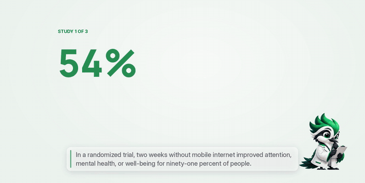</td>
<td width="55%" valign="top">

| | Finding | Source |
|---|---|---|
| **91%** | of people improved attention, mental health or well-being after 2 weeks without mobile internet (RCT) | Castelo et al., [PNAS Nexus 2025](https://doi.org/10.1093/pnasnexus/pgaf017) |
| **26 min/day** | more phone time cut when people **chose their own** goal (73% larger; RCT, N = 149, 12 weeks) | Sachdeva, Somasundaram & Sharma (IIM Udaipur, ISB), [Soc Sci Med 2026](https://doi.org/10.1016/j.socscimed.2026.119683) |
| **57%** | fewer openings of target apps with a short pause first (the *one sec* app) | Grüning, Riedel & Lorenz-Spreen, [PNAS 2023](https://doi.org/10.1073/pnas.2213114120) |
| **90% vs 13.7%** | of people accepted reward programs vs deposit programs (n = 2,538); deposits worked better among those who took them (+13.2 pts) | Halpern et al., [NEJM 2015](https://doi.org/10.1056/NEJMoa1414293) |
| **2×** | Appointments **more than doubled** uptake vs financial commitment devices; most commitment-device takers lost their money | Derksen et al., [arXiv 2110.06876](https://arxiv.org/abs/2110.06876) |
| **+3.2 kg** | Group-pooled incentives beat individual ones for weight loss (95% CI 0.9–5.5) | Kullgren et al., [Ann Intern Med 2013](https://doi.org/10.7326/0003-4819-158-7-201304020-00002) |
| **98.4%** | Accuracy of a motion signal at telling human from AI-agent-driven logins (table-top; 92.6% hand-held; 116 pilot sessions) | Liu & Huang, [arXiv 2609.02154](https://arxiv.org/abs/2609.02154) |
| **9 of 12** | NFT play-to-earn games where trading players lost money on average | Gao et al., [arXiv 2602.13882](https://arxiv.org/abs/2602.13882) |

</td></tr></table>

<table><tr>
<td width="150" align="center"></td>
<td>

**Pip, reading the papers:** "Here's what the research told us to build. **Rewards first**, because almost nobody
signs up to lose money (Halpern). **Daily appointments**, because they beat penalties (Derksen). **You pick the
length**, because self-chosen goals work 73% better (Sachdeva). **A pause before the app opens**, because it halves
openings (Grüning). **Squads**, because groups pull harder (Kullgren). And **no new token**, because emission-funded
games leave players at a loss (Gao)."

</td></tr></table>

## 3. What FACEDOWN does

| | Feature | How |
|---|---|---|
| ⏱️ | **Book a session** | A daily time with a reminder, and a length: **2, 10, 25 min or a Facedown Hour**. Pick **Free** (a sponsor pays), **No-Loss** (lock SKR, always get it back, only finishers earn) or **Stake** (finish for your stake back + up to 20% from sponsors). |
| 📱 | **Put it face-down** | The screen goes black. The phone buzzes a few times at moments you can't predict; **knock on the back** to answer. One missed knock is forgiven. |
| 🧪 | **Prove it** | The accelerometer proves the phone lay face-down and still, and that every answer was a physical knock, not input injected by a script or AI agent. The server times everything on its own clock. |
| ⛓️ | **Get paid on-chain** | The verified session is attested on Solana and paid **in the same transaction**. Anyone can check it on Explorer. |
| 🔒 | **Cool-down Lock** | Quit a Stake session and your stake is **locked for 7 days** (14, then 30 for repeat quits), then it comes back. Never lost, never given to anyone else. |
| 🛑 | **Urge Catcher** | Open Instagram, YouTube or X and FACEDOWN pauses first: *go facedown 10 min instead?* Or **Earn your scroll**: 60 seconds face-down (counted toward Presence Minutes) unlocks the app for 10 minutes. *Open anyway* still works after 10 seconds. |
| 🟢 | **Presence Minutes** | Whenever the phone lies face-down and still, a ring on Today fills toward a 3-hour daily goal, without opening the app. |
| 👥 | **Squads** | 3–8 friends share **one streak** that breaks for everyone if anyone misses a day. A **streak freeze** (2 SKR, half burned on-chain) covers one missed day, and a missed day can be **repaired within 24 hours** by buying one then; after that the streak restarts. |

<p align="center">
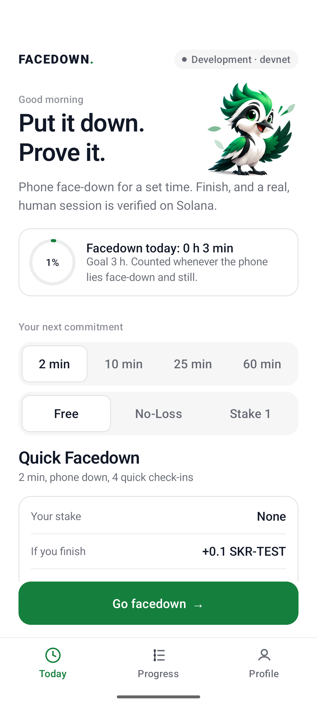
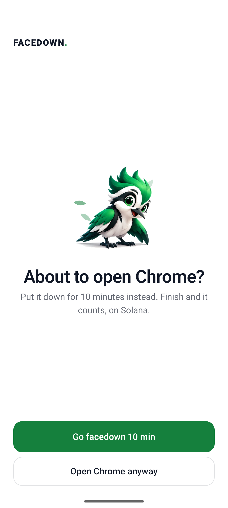
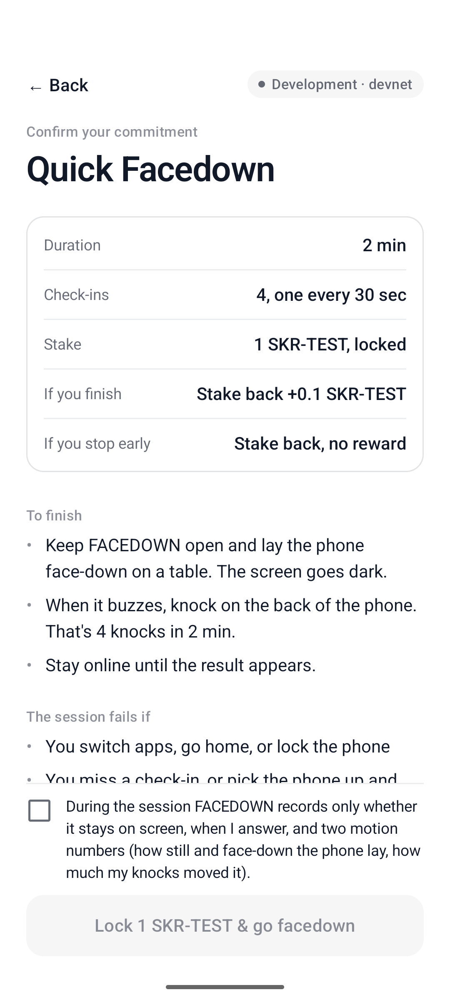
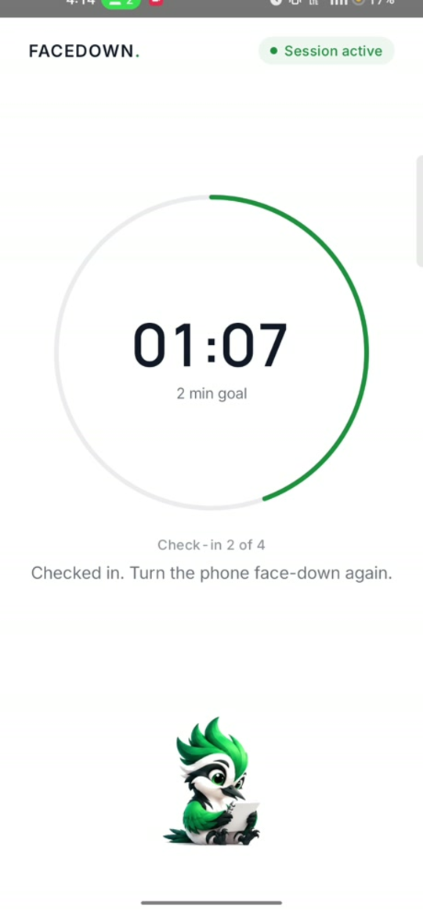
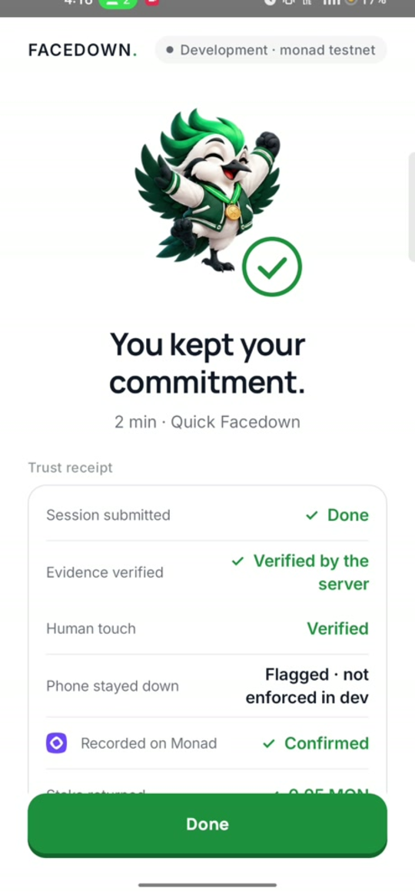
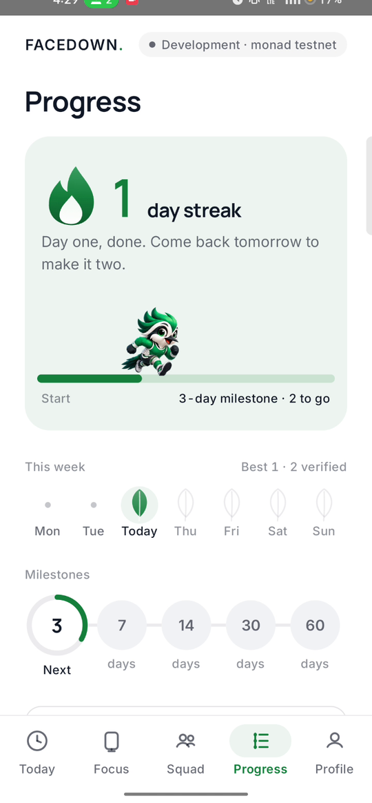
<br><sub>Today · Urge Catcher · Confirm · Face-down · Receipt · Progress. Android emulator on <b>devnet</b>, development mode
(Seeker check bypassed and labelled). Rewards are SKR-TEST, a valueless test mint.</sub>
</p>

## 4. FACEDOWN in four moments

<table>
<tr>
<td width="50%" valign="top">

**① Choose how long, and what's at stake.** 2, 10, 25 or 60 minutes. Free, No-Loss or Stake, with the exact terms
on screen before any wallet prompt. Your wallet signs once.

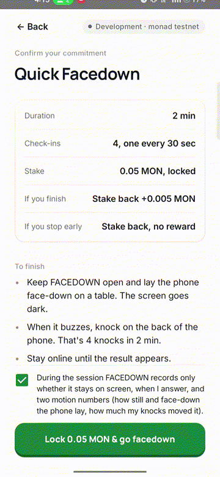

</td>
<td width="50%" valign="top">

**② Put it face-down, knock when it buzzes.** The screen goes dark. Check-ins come at unpredictable moments; a knock
on the back answers without picking the phone up.

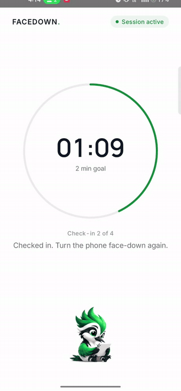

</td>
</tr>
<tr>
<td valign="top">

**③ The server verifies, the flame lights.** Server-timed duration, every hash in the evidence chain, human touch and
phone-down. Then the stake comes back with a bonus, on Solana.

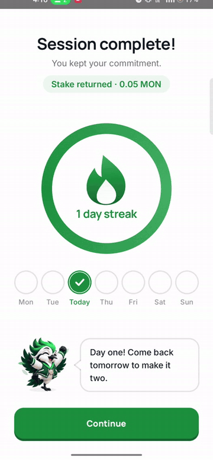

</td>
<td valign="top">

**④ Bring friends, catch the urge.** A squad shares one streak. Reach for a distracting app and FACEDOWN asks first.

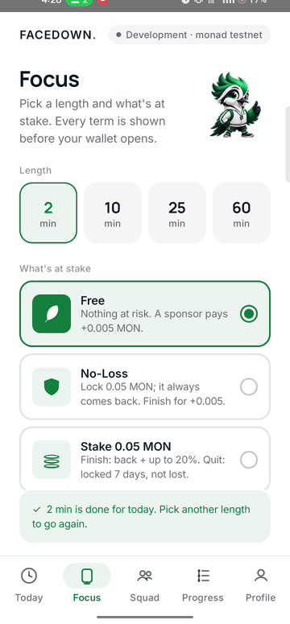
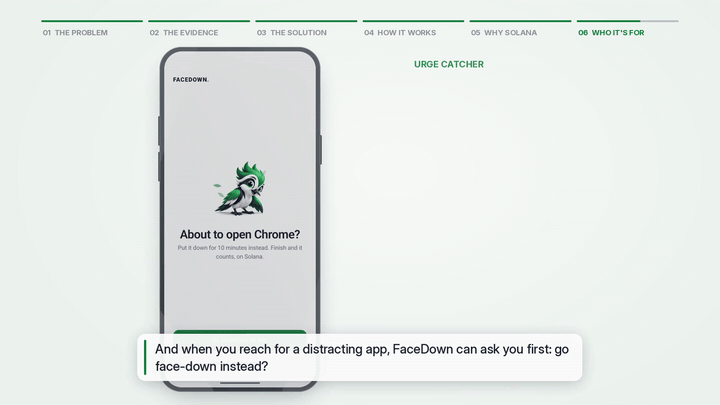

</td>
</tr>
</table>

<table><tr>
<td width="150" align="center"></td>
<td>

**Pip, on guard duty:** "People ask me: *can't you just cheat?* Try it. Here's what happens."

</td></tr></table>

| Attempt | Why it fails |
|---|---|
| Fake the timer / fast-forward | The **server** times the session from its own clock. Checkpoints that arrive early are rejected. |
| Use the phone during the session | Leaving the app is recorded in every checkpoint and fails the session. Picking the phone up breaks face-down stillness. |
| Let a script or an AI phone agent answer | Answers are knocks felt by the accelerometer (or a finger tap's jolt). Injected input moves nothing: production rejects it (`AUTOMATION_DETECTED`). **Measured on a real phone below.** |
| Replay or forge evidence | Checkpoints form a SHA-256 hash chain signed by a per-session Android Keystore key bound into the wallet's sign-in. |
| Farm sponsor pools with many wallets | One claim per **Seeker Genesis Token** per mission per day: a device, not a wallet. |
| Swap the stake transaction in the wallet | ATTEST submits the stake only if it moves exactly what was issued; wallets may add priority fees, nothing else. |
| Claim the payout twice | Payout and attestation are one transaction on a PDA that can be created once. |

## 5. Live proof on Solana devnet

Every row is a real transaction. Click through to Solana Explorer.

| | |
|---|---|
| Program | `CFZsFPtvwo5KDenV3qgorroaRmT7NuYsfPnd4avFS2cT` |
| SKR_TEST mint (6 decimals) | `GGqPuCZvbfmVuaUDU5AHqSxrMSbM9L3qJMP1Q7p7myRU` |
| **Face-down session** (emulator): 4/4 knocks, human touch + phone-down verified, attestation + sponsor reward | [2R1V…xiit](https://explorer.solana.com/tx/2R1VrBwdbkXkpfZ1eQLRAkM6BNMXryes7u3KAQs689QRw6PBNw1PUxzTRz5PfhatMRPSHy5JRxnHwFvEgNiWxiit?cluster=devnet) |
| **No-Loss**: quit mid-session, stake refunded | [a6Em…iE1](https://explorer.solana.com/tx/a6Em7BAUah1osjjuJUWzi9JHAqsycLuAtyhthDXUVZwG1jJ5q5gTr4ZzsJioWiA1pAA4eXRRXVA2kiF1cjpiiE1?cluster=devnet) |
| **Streak freeze**: 2 SKR-TEST paid | [7qc5…R9r](https://explorer.solana.com/tx/7qc5aKgJ76qzy8idtPqSxtrfDbtcjqbPcpJ5rLLbzn1pHbB4pJGBsPS5QQkNMscSee4wBpkJCZvkK2ED25KeR9r?cluster=devnet), 1 SKR-TEST **burned** [2FDV…aMf](https://explorer.solana.com/tx/2FDVJdb2azN4pAD3cPEjn3bdzXCDrvXvaV586kMoDzYBkkxt1xTZngBqvBxwdumNYdTMDKTifTvWPMDrwAXESaMf?cluster=devnet) |

**Real phone (realme, Android 13) + Solflare on devnet, current build, app restarted between runs:**

| | |
|---|---|
| Free session: attestation + 0.1 sponsor reward | [65dm…sVCe](https://explorer.solana.com/tx/65dmpG1SiBEnUh9YJk358JnkDSrThrqsZBJdteKqdfLq5Gw9NmRGyypCrJn8zMjtkdMhUFmpqnDHc3t6bC9XsVCe?cluster=devnet) |
| No-Loss: 1 SKR-TEST locked [htM3…jrBd](https://explorer.solana.com/tx/htM37NsU3bZD1pASmiWQZnU72uZZi5HbuwUQ43xSYReU5TgsES8RCjjwSsa5ARxf3fzt6mCRvvNobGYMUBtjrBd?cluster=devnet), finished: stake back + reward | [3tLy…SLMo](https://explorer.solana.com/tx/3tLytYKxxyQpTkWh8sb2nJhYie29yhcHKJ4ZTXuAATjAucSCmHZkF43g5TehjiTH7GTqQAq6bC5oz5kisH1DSLMo?cluster=devnet) |
| Stake: 1 SKR-TEST staked [3CwX…fNB5](https://explorer.solana.com/tx/3CwXnpdqZ4HQScAPvYg9LBrssLBm9baTzBdSc4yhvYc59QQqN27AzvRamXBGW3rFe1o4oqYx8d84Rpkm2dRPfNB5?cluster=devnet), finished: attestation + stake back | [RGkd…guRZ](https://explorer.solana.com/tx/RGkdQhLmhLcnrQetyQvRB5SFVvZt9qfMAvZikSnEo5tWBms93ZhnMpxcSnQ89TumMWyFmxNWdYi5ccL6jsWguRZ?cluster=devnet) |
| Stake, then left the app: **Cool-down Lock**, stake locked until Oct 19 (not lost) | stake [3XhH…3G5b](https://explorer.solana.com/tx/3XhHZQcfWt3qN7zZGo6UN7T73TEd2v9PLhiF8zEfgZu5sbmXutCKb3P6wBhxFr6cvCkARkYRnQw8VskKcxoS3G5b?cluster=devnet) |
| Streak freeze signed in Solflare (shown as −2 SKR-TEST) | paid [4Csv…GXxp](https://explorer.solana.com/tx/4CsvYY3pBxRgzhieUFj4wCDuNNtHjHtp4GPt8NuSdTSxD8vYr8einDYz3TQJ3Rw6f8ejC8VgdMreq3U8L8iYGXxp?cluster=devnet), burned [pcoH…Cz7n](https://explorer.solana.com/tx/pcoHdAfvkr3srTj5RnMnUyY9A7ojNogQigTtacHUpNBUzZ66aQDZrxDffyF2kaEDpZkjiUNfHPhDLLpGE1HCz7n?cluster=devnet) |

Earlier face-up build on the same phone (Oct 11): stake [yKF8…8qnt](https://explorer.solana.com/tx/yKF8g4evQLErYHiELKfR5sHHPyyFq1nkGPZSG4bLV6vZ4tfsgf4o3TX2f3Jz7pfzQkhMjwzn6Ce16WWLBZn8qnt?cluster=devnet) → stake back + bonus [5vbS…i6Nd](https://explorer.solana.com/tx/5vbSaLXNDUZ1Q2zMqKBrV1n4a5wEqiPRSficKMqeckktqczxPraxxrPtcLgVfx2rgm45YNAcsaMzLADK9KmHi6Nd?cluster=devnet); free [2gtc…obNu](https://explorer.solana.com/tx/2gtcaWDPiB3uanDdia8iP6n96G6oTDnb4VjMJjWT2JAzRytcQh8cKB3wbSj16Rvi6yepuVWqCiZnKKEERPrZobNu?cluster=devnet).

**What a real wallet taught us** (all fixed):
- Solflare rotates the Mobile Wallet Adapter auth token on every approval; reusing the first one after an app
  restart fails with "authorization request failed". Every wallet call now saves the newest token and retries once.
- Solflare adds priority-fee instructions before signing; ATTEST accepts those and refuses any other change
  (unit-tested: a changed amount, recipient or payer is still refused).
- Solflare sometimes called a devnet stake "for mainnet". Building stakes on a finalized blockhash made it go away;
  our reading is that its RPC hadn't seen a just-confirmed hash yet, but that's not confirmed.

### What we measured

From the devnet database (9–12 Oct 2026: **56 sessions, 20 wallets, 19 settled, 9 rejected**) and the
[whitepaper](docs/whitepaper/presence_whitepaper.pdf):

<table><tr>
<td width="50%">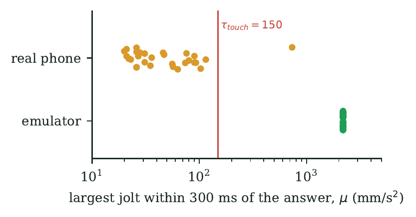</td>
<td width="50%" valign="top">

**Scripts get caught by physics, not by timing.** Our real-phone runs were driven by `adb input tap`, the same kind
of injected input a bot or AI agent produces. **29 of 30 injected taps** read 20–115 mm/s² of motion (median 35.5)
against a 150 mm/s² human-touch floor, so all 8 of those sessions would be rejected in production. Their answer
*timing* looked perfectly human: timing alone catches nothing.

**And we say where it breaks.** The emulator's virtual accelerometer passes easily (2,189 mm/s²). A device that lies
about its own sensors beats the check today. Hardware attestation is the fix (P4 on the roadmap).

</td></tr></table>

| Measured | Result |
|---|---|
| Rejections in the deployment | 7 for leaving the app, 2 for missed check-ins, 0 for timing |
| Answer time to a check-in | median 3.07 s, min 344 ms (none under the 150 ms human floor) |
| Verify a session (hash chain + 9-clause policy) | **16 µs** median for 4 checkpoints, linear in length |
| Cost of one verified session on Solana | **1 transaction, 1 signature, 27–30k compute units, 0.00144 SOL**, paid by the operator, not the user |
| Backend tests | 50 pass (2 skipped): protocol, replay, policy, physical evidence, stakes, No-Loss, cool-down, freezes, squads, daily reward cap, streak repair, RPC backoff |

## 6. Why Monad

PRESENCE needs a chain where a proof of presence is cheap to write, fast to finalise, and readable by **any** contract,
especially the EVM wallets and agent frameworks that AI agents already use. Measured on Monad testnet, 13 Oct 2026:

| Measured | Result |
|---|---|
| Recording one verified session (`record()`) | **1 transaction, 161,016 gas**, about 0.0164 MON at the testnet gas price of 102 gwei |
| Block time, averaged over 1,000 blocks | **0.304 s** |
| Contracts | `PresenceRegistry` and `HumanGatedVault`, both source-verified (Sourcify exact match) |

- **Composable by default.** It's the EVM, so any wallet, vault, quest or agent framework can call
  `isPresent(identity, minAssurance, maxAgeDays)` with no SDK. `HumanGatedVault` is about 50 lines.
- **Fast enough to sit in the loop.** With sub-second blocks, a presence proof can gate an agent's next action
  instead of a batch job hours later.
- **Agents live here.** Embedded and agent wallets on Monad (Privy, Dynamic, MetaMask Agent Wallet) are exactly the
  accounts that need a "was a human actually here?" check before high-value actions.
- **Privacy.** The registry stores only SHA-256 hashes of the device identity and the mission, plus a 32-byte evidence
  root. Raw sensor data never leaves the phone.

**Where Solana still fits.** The FACEDOWN app was first built for Solana Mobile: its wallet (Solflare through Mobile
Wallet Adapter), SKR-TEST rewards and the Seeker Genesis Token device identity run on Solana devnet today (section 5).
The ATTEST server now records every verified session on Monad as well, so the same human proof is readable from
Monad contracts.

## 7. SKR: a reason to hold and spend it, not just pass it through

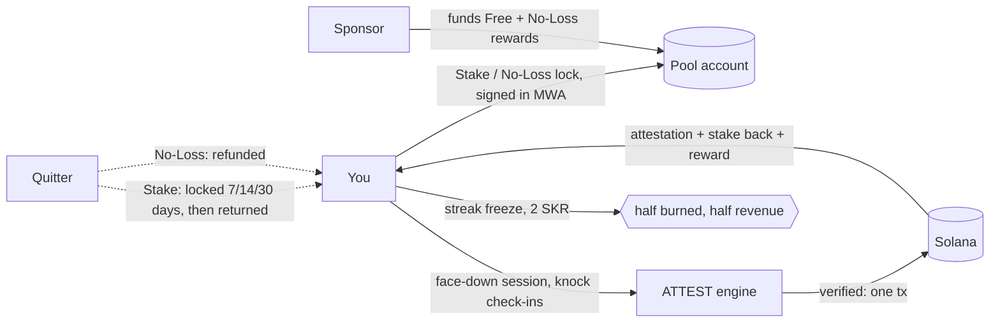

| | Free | No-Loss | Stake |
|---|---|---|---|
| **At risk** | nothing | your stake, during the session | your stake |
| **Finish** | sponsor reward | stake back + sponsor reward | stake back + up to 20% from the sponsor pool |
| **Quit** | nothing | stake refunded | stake **locked 7 days** (14, then 30), then returned |

<table><tr>
<td width="60%">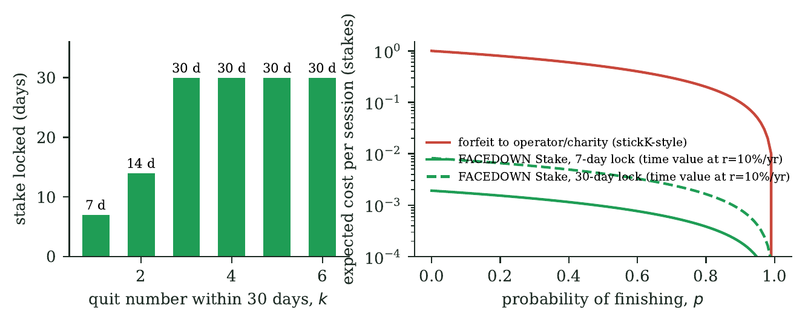</td>
<td width="40%" valign="top">

**Loss aversion without a gamble.** Classic commitment contracts take your money when you fail. FACEDOWN locks it
instead. The money cost of quitting is the time value of a short lock: **under 1% of a forfeit** at a 10% yearly rate.
What's left is the feeling of not having it, which is the point.

**Nobody's stake is ever paid to anyone else.** Rewards come only from sponsors, so FACEDOWN is designed to stay outside
"online money game" under India's 2025 online gaming law. That's our reading, not legal advice; it needs review before
a public launch.

- **Real SKR** is `SKRbvo6Gf7GondiT3BbTfuRDPqLWei4j2Qy2NPGZhW3` (6 decimals). Everything is transfer-based, so pointing
  `REWARD_MINT` at it is the mainnet switch.

</td></tr></table>

<table><tr>
<td width="150" align="center"></td>
<td>

**Pip, talking business:** "FACEDOWN is the first app. **PRESENCE is the company.** Every airdrop is a Sybil problem
and every quest program is a farming problem. We sell the answer: *a real human did this, on this device*, provable by
anyone on-chain."

</td></tr></table>

## The business

- **Consumer (FACEDOWN):** sponsor-funded Free and No-Loss tiers for reach; streak freezes as an SKR sink and revenue;
  later a Pro tier and a small rake on opt-in Stake pools (where legal).
- **Infrastructure (PRESENCE):** proof-of-human-process per attestation, sold to airdrop issuers, quest platforms and
  Seeker campaigns. "5 verified facedown sessions" is a quest a bot can't farm.
- **Sponsors:** parents funding a student's pool, companies funding employees' focus hours, protocols funding
  campaigns. Sponsor deposits are verified on-chain before they're credited.
- **No new token, no emissions.** Rewards are transfers from sponsor pools, so the economy can't inflate away.

## 8. The engine: PRESENCE

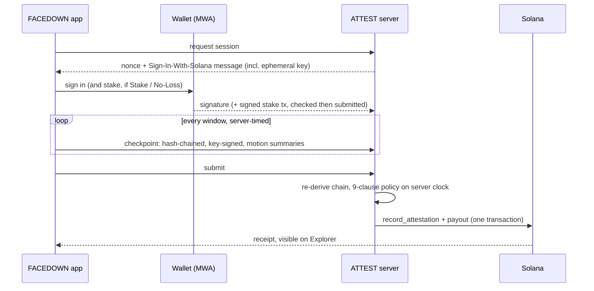

- **Client collects, ATTEST decides, chain anchors.** The app never sends `verified`, `reward` or `assurance`.
- **Evidence chain.** `checkpoint_i = SHA256("PRESENCE/cp/v3" | prev | "{i}|{ts}|{elapsed}|{fg}|{taps}|{response_ms}|{still_pct}|{touch_motion}" | nonce)`,
  identical in Kotlin and Python (shared golden vectors).
- **Privacy.** Per window: a foreground flag, an answer count, one answer time and two motion summaries. Raw sensor data
  stays on the phone. No location, contacts, camera or microphone. Only a 32-byte root goes on-chain.
- **Assurance levels.** P1 = wallet sign-in + Seeker Genesis Token, P2 = P1 + process evidence. P3 (witnesses) and
  P4 (hardware attestation) are designed, not built.

<table><tr>
<td width="50%">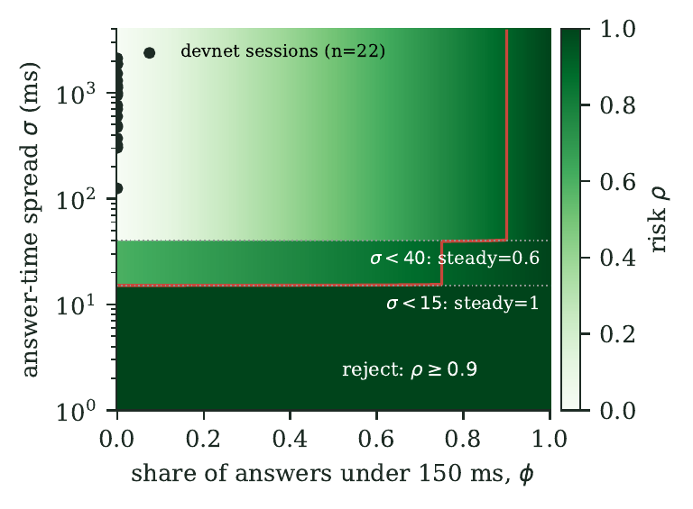</td>
<td width="50%" valign="top">

**The full maths is in the [whitepaper](docs/whitepaper/presence_whitepaper.pdf)** (14 pages): the threat model, the
9-clause server predicate, the knock and stillness detectors, the automation-risk score, the evidence chain, pool and
cool-down economics, streak survival, the on-chain uniqueness rule, measured results and a ranked list of limitations.

Docs: [architecture](docs/architecture.md) · [trust model](docs/trust-model.md) ·
[evidence](docs/evidence-model.md) · [security](docs/security.md) · [missions](docs/mission-policy.md) ·
[integration](docs/integration.md) · [demo script](docs/demo.md)

</td></tr></table>

## 9. Roadmap (designed, not built)

- **P4 hardware attestation.** Android Key Attestation for the session key, so a phone that lies about its sensors is
  refused. Closes the biggest gap we measured.
- **Guardian quorum.** Several attestors staking SKR instead of one operator, each re-checking the same evidence
  ([trust-model.md](docs/trust-model.md)).
- **Yield-funded No-Loss.** On mainnet, locked stakes earn yield (e.g. a USDC/SOL lending vault) that funds the
  finisher reward instead of sponsors. Not built: no such vault on devnet to test against.
- **ORE sponsor pools ("your focus fills an ORE jar").** A mission whose reward mint is ORE, funded by an ORE sponsor.
  We deliberately do *not* deploy users' SOL into ORE mining rounds: that is a game of chance and would undo No-Loss.
  ORE runs on mainnet only.
- **Presence Model.** Replace the hand-tuned knock/stillness thresholds with a small on-device classifier trained on
  real session traces (opt-in). Not built: we don't have the data yet, and a model without data would be theatre.
- **Share a receipt as a Solana Blink** so anyone can join your squad or challenge you from X.
- **Presence Passport.** A monthly soulbound badge for verified presence that other apps read through `verifyPresence()`.
- **Urge Forecast.** Suggest Facedown Hours from the phone's own usage stats (the hours you lose most).
- **Pledge mode.** Quitting sends the stake to a cause you pick instead of locking it (needs legal review).

<table><tr>
<td width="150" align="center"></td>
<td>

**Pip, being honest:** "Read this before you quote us. We'd rather you hear the limits from us."

</td></tr></table>

## 10. Honest limitations

- **Real phone: yes. Real knocks: not yet.** Free, No-Loss, Stake, Cool-down, freezes and squads ran on a real
  realme phone with Solflare on devnet (table above), with check-ins answered by on-screen taps. Face-down and knock
  detection were verified on the emulator's virtual accelerometer; a calibrated real-knock session is still to do.
  Seeker Genesis Token verification is implemented and unit-tested but not run on a Seeker.
- **Knock thresholds need real data.** Each user calibrates their own knock (half their median, never below
  0.2 m/s²); the server's human-touch floor is 150 mm/s². On a real phone, injected taps read 20–115 mm/s² (one 734
  outlier). A measured table across surfaces and phones is still to do.
- **Signals, not proof: a privileged agent can fake motion.** ActReal ([arXiv 2608.30038](https://arxiv.org/abs/2608.30038))
  shows that system-level mobile agents can generate time-aligned touch and six-axis IMU signals, evading touch+IMU
  detectors 71.1% of the time. So accelerometer evidence alone can be spoofed by a privileged agent (our emulator's
  virtual sensor passes too). Our defence today is server-side timing, the signed hash chain and per-device claim and
  reward caps; the real fix is hardware key attestation (P4 on the roadmap).
- **Three classes, not two.** Binary human-vs-bot detectors misroute AI agents: one benchmark found 34.5–39.1% of agent
  sessions classified as human, while an explicit agent class caught them ([arXiv 2607.26935](https://arxiv.org/abs/2607.26935),
  browser automation). That is why the planned Presence Model is a human / script / AI-agent classifier. The 98.4%
  human-vs-agent figure we cite ([arXiv 2609.02154](https://arxiv.org/abs/2609.02154)) comes from a 116-session pilot.
- **This phone, not you.** It proves *this* device lay face-down with a person answering. It can't stop you using a
  second phone. In No-Loss you only cheat yourself; in sponsored pools the Genesis Token caps it to one device.
- **The behavioural effect of FACEDOWN itself is unmeasured.** We cite trials of related interventions; we haven't run
  our own yet.
- **Indian law.** Rewards come only from sponsors and nobody's stake is ever paid to someone else, which is designed to
  stay outside "online money game" under India's 2025 online gaming law. That's our reading, not legal advice.
- **Presence Minutes and Urge Catcher were verified on the emulator only.** The emulator stops sensor delivery
  with its screen off, so screen-off sampling on real phones still needs checking. Urge Catcher is an accessibility
  service the user switches on in Android settings (some phones, like realme, don't let adb do it).
- **Single operator.** One attestor key and one ATTEST server, run locally for these tests (not publicly deployed).
- **Test tokens only.** Devnet and localnet use SKR-TEST and a dev-only faucet, which the server refuses on mainnet.

## 11. Run it

```bash
. scripts/toolchain.env
anchor build
scripts/dev_stack.sh                 # validator + program + SKR_TEST pools + ATTEST (dev mode) on :8787
./gradlew :app:installDebug          # emulator reaches the host at 10.0.2.2
```

Install Solana Mobile's `fakewallet-v1-debug.apk`
([MWA releases](https://github.com/solana-mobile/mobile-wallet-adapter/releases)) on the emulator. New test wallets
are funded by the dev faucet on connect. For devnet: `scripts/devnet_setup.sh`, then `scripts/fund_pool.sh`.
On the emulator, `adb emu sensor set acceleration 0:0:-9.81` turns the phone face-down.

### Tests

```bash
cd backend && uv run pytest -q                 # 50 tests: protocol, replay, policy, physical evidence, N-1, stakes, No-Loss, cool-down, freezes, squads, reward cap, repair window
scripts/e2e_localnet.sh                        # real chain: deposit, stake round trip, forged stake refused, payout, SDK
anchor test --validator legacy                 # program: attestor auth, day range, claim index, streak, double settlement
./gradlew :app:testDebugUnitTest               # evidence chain = Python golden vectors; knock / calibration / face-down detector; Presence Minutes
python3 scripts/device_e2e.py <adb-serial> happy free leave   # drives the real app + wallet on a device/emulator
ATTEST_ENFORCE_PHYSICAL=true scripts/dev_stack.sh   # then `device_e2e.py emulator-5554 free`: injected taps are rejected
```

## Credits

- **Film:** stock footage from [Pexels](https://www.pexels.com) (Pexels License); music "Mountains" by Andrew Ev
  ([Mixkit](https://mixkit.co) licence); voice by Kokoro-82M TTS (Apache-2.0). Every app screen is the real app.
- **Fonts:** Manrope and Inter (SIL OFL). **Solana logo:** from Solana's brand assets.
- **AI tools:** Claude Code (Anthropic) wrote much of the code, tests, docs, whitepaper and film under the team's
  direction and review.

## Team WARRIO

- **Aaditya** (iocryp15), lead · [@Aaditya1273](https://github.com/Aaditya1273)
- **nebula10**

<table><tr>
<td width="150" align="center"></td>
<td>

**Pip, signing off:** "Put it down. Prove it. Start with 2 minutes."

</td></tr></table>
