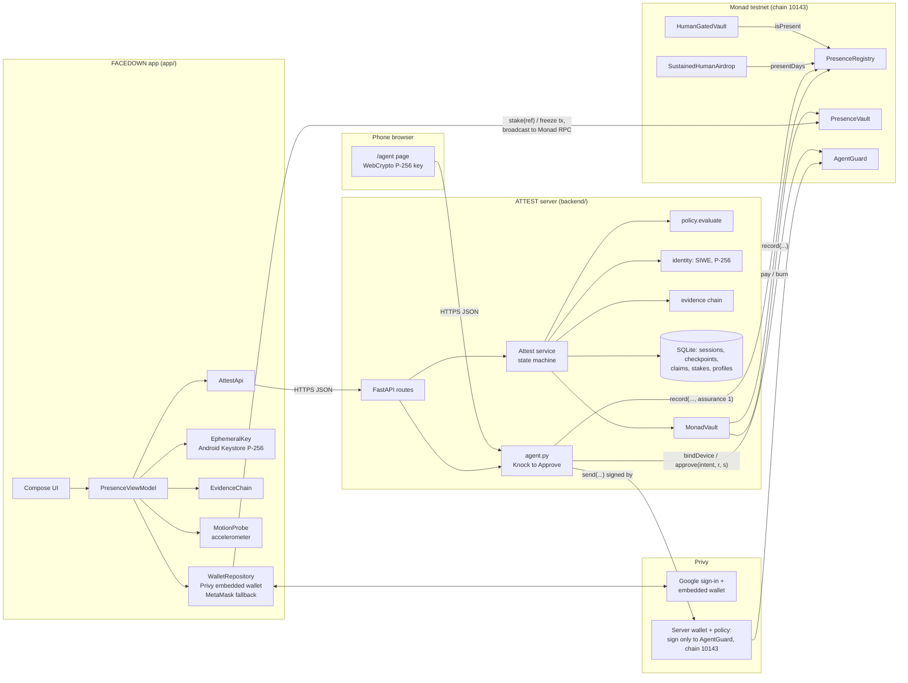
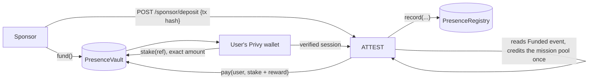

# Architecture

PRESENCE has three parts with one trust boundary: **the client collects evidence, ATTEST decides, Monad records.**
Wallets come from Privy: the app's users sign in with Google and get an embedded wallet, and the AI agent in the
Knock to Approve demo is a Privy server wallet.

## Repository layout

| Path | What it is |
|---|---|
| `app/` | Android app (Kotlin, Jetpack Compose, Hilt, Privy Android SDK) |
| `backend/attest/` | ATTEST server (Python 3.12+, FastAPI, SQLite, `cryptography`, `eth-account`) |
| `backend/missions_monad.json` | Mission policies used by the live server (data, not code) |
| `backend/tests/` | Backend tests and `sim.py`, a reference client |
| `backend/scripts/knock_e2e.py` | Live Knock to Approve check against a running ATTEST (bind, small send, held send, forged signature, real approval) |
| `contracts/` | Foundry project: `src/` (5 contracts), `test/` (10 tests), `deployments/monad-testnet.json` (addresses and tx hashes) |
| `scripts/monad_demo.py` | Runs a simulated client session against a running ATTEST and prints the Monad record |
| `render.yaml` | Deployment of the live server at https://presence-h7uy.onrender.com |
| `legacy/solana/` | An earlier Solana prototype, archived; not part of the live system |

## Contracts (`contracts/src`, all on Monad testnet)

| Contract | Address | Role |
|---|---|---|
| `PresenceRegistry` | `0x5519dacface816519ACa3ee3cD592fd4c61dE52B` | One record per verified session: `record(identity, mission, day, seq, evidenceRoot, assurance)`, create-once. Reads: `isPresent`, `presentDays`, `profileOf`, `attestationOf`. Only allowlisted attestors write. |
| `PresenceVault` | `0xfC157D4b8D9573413a3A793056D7625eD972163B` | Holds stakes and sponsor funds in MON. Users call `stake(ref)`, sponsors call `fund()`; only the attestor can `pay` or `burn`. |
| `AgentGuard` | `0xdC3Ba526FF565D0c76131D54a30aFA3c55041B11` | Knock to Approve. The agent may send up to 0.01 MON alone; larger sends become intents that execute only with a P-256 signature from the bound phone, checked on-chain through the precompile at `0x100`. |
| `SustainedHumanAirdrop` | `0x62CbaaAc53ef415fE0262E41e3ce4C2B9af164d1` | Example consumer: pays 0.005 MON once per identity present on at least 3 of the last 30 days. |
| `HumanGatedVault` | `0x2AF710af85914DEe0AA89017223638367645f6b4` | Example consumer: an agent can withdraw small amounts; above the limit it needs `isPresent(owner, 2, 1)`. Reads the first registry (v1). |

The attestor for all of them is `0x5aB3036C7d0bA7043E0BB531374dC6c732eC4954`. Every deployment and demo
transaction hash is in `contracts/deployments/monad-testnet.json`.

## Android modules (`app/src/main/java/com/presence`)

| Package | Responsibility |
|---|---|
| `wallet/` | `WalletRepository`. With Privy IDs in the build: Google sign-in through Privy, which creates an embedded Ethereum wallet. It signs the session's SIWE message (`personal_sign`) and the stake and freeze transactions (`eth_signTransaction`); the app broadcasts them to `https://testnet-rpc.monad.xyz` itself. Without Privy IDs it falls back to MetaMask: the app opens ATTEST's `/metamask` page in MetaMask's browser and polls ATTEST until the signature arrives. Stores only the public address. |
| `evidence/` | `EvidenceChain` (hash chain, mirrors `evidence.py`), `EphemeralKey` (Keystore P-256), `MotionProbe` (stillness, face-down, knock detection) |
| `attest/` | Typed HTTP client and DTOs; maps server failures to `AttestException(reason)` |
| `session/` | `PresenceViewModel` runs the mission; `PresenceState` holds UI state and reason copy |
| `urge/` | Urge Catcher (pauses before a distracting app opens) |
| `ui/` | Theme and screens. No business logic in composables. |

## ATTEST modules (`backend/attest`)

| Module | Responsibility |
|---|---|
| `service.py` | The state machine; the only place PASS/FAIL, claims, caps and rewards are decided |
| `policy.py` | Typed `MissionPolicy`, the single `evaluate()` |
| `evidence.py` | Chain and root definitions |
| `identity.py` | SIWE (EIP-4361) message, EIP-191 `personal_sign` check, P-256 session key check, device-eligibility verifier (bypassed and labelled in development mode) |
| `monad.py` | ABI-encodes and sends `record(...)` to `PresenceRegistry`; Monad RPC helpers |
| `monad_vault.py` | `MonadVault`: issues `stake(ref)` transactions, checks the `Staked` event, records the session, pays stake + reward, refunds, burns, verifies sponsor `fund()` deposits |
| `agent.py` | Knock to Approve routes (`/agent`, `/agent/bind`, `/agent/request`, `/agent/approve`); the agent signs through a Privy server wallet, or a local key for development |
| `settlement.py` | The `Attestor` interface the service calls (`settle`, `build_stake_tx`, `submit_stake`, `refund`, `burn`, `verify_deposit`) |
| `reputation.py` | Streak, league, counters |
| `anomaly.py` | Automation heuristics over check-in answer times (statistics, not ML) |
| `mission_generator.py` | Plain language → draft mission policy, validated by `build_policy` |
| `store.py` | SQLite schema (durable nonce, claim and stake state) |
| `errors.py` | Every failure reason |
| `app.py` | HTTP routes only; also serves `/agent`, `/monad` and `/metamask` pages |

## Money flow (testnet MON, no value)

- **One vault, per-mission accounting.** All MON sits in `PresenceVault`. Which share belongs to which mission's
  sponsor pool is ATTEST's bookkeeping in SQLite, not on-chain state.
- **Stakes come back.** No-Loss stakes are refunded whether or not the session passes. Stake (cool-down) missions
  return the stake on success; on a quit it is locked for 7 days (14, then 30 for repeat quits within 30 days) and then
  refunded. No stake is paid to another user.
- **Rewards are capped per device identity per day** (`DAILY_REWARD_CAP_PER_DEVICE`, 0.1 MON on the live server).
  Stakes don't count against the cap.
- **Record, then pay.** `MonadVault.settle` sends `record(...)` first and `pay(...)` second, as two transactions. If
  the record fails, nothing is paid. A retry after a recorded-but-unpaid session fails at `record` (`AlreadyAttested`)
  rather than paying twice; it needs manual follow-up.
- **Unfunded still records.** If a mission's pool can't cover the reward, the session is still recorded and the
  receipt says `UNFUNDED`.
- **Streak freezes** cost `FREEZE_PRICE` (0.02 MON on the live server), paid with `stake(ref)`; ATTEST burns half to
  `0x…dEaD` through `burn()`.

## Status

- **Implemented and deployed on Monad testnet:** the five contracts above; ATTEST with Monad settlement; Google
  sign-in and in-app signing via Privy; MetaMask fallback; Knock to Approve with a Privy server wallet; P1 and P2
  assurance; per-device daily reward cap; automation heuristics; mission drafting.
- **Planned:** several independent attestors (the registry already supports `setAttestor`); hardware key attestation
  (P4); P3 witnesses.
- **Experimental:** the web-browser knock on `/agent` (recorded at assurance 1).
