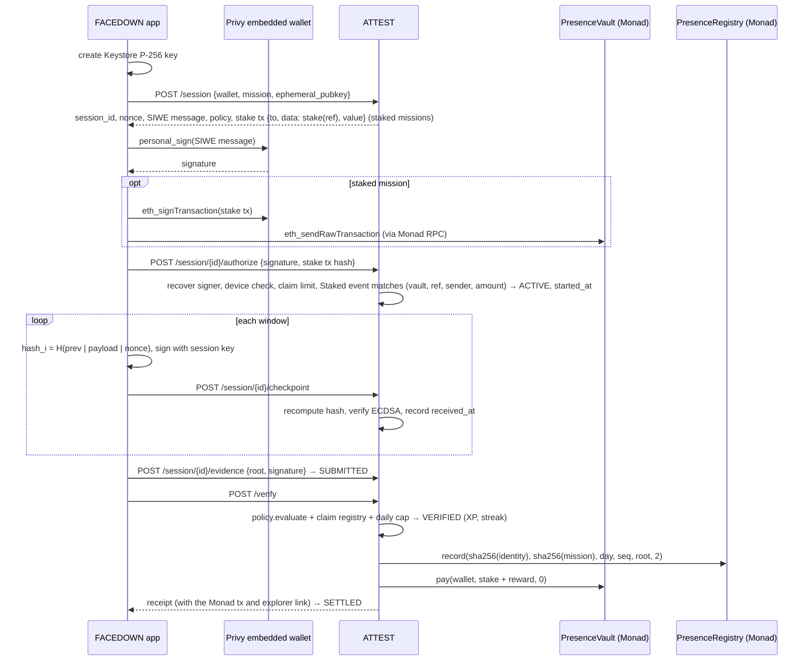

# Evidence model

## Session

| Field | Where | Notes |
|---|---|---|
| `session_id`, `nonce` | ATTEST | `uuid4`, 128-bit `secrets.token_hex`; nonce is `UNIQUE` in SQLite |
| `siws_message` | ATTEST | The exact SIWE (EIP-4361) text the wallet must sign: domain, wallet address, `Chain ID: 10143`, nonce, session id, issued/expiry times, and the session key's fingerprint as a resource (`presence:ephemeral-key:<sha256>`) |
| wallet signature | Privy embedded wallet (or MetaMask) | `personal_sign` (EIP-191) over that message; ATTEST recovers the signer and requires it to equal the session's wallet |
| `ephemeral_pubkey` | Android Keystore | EC P-256, created per session, deleted after it |
| `started_at`, checkpoint `received_at`, `submitted_at` | ATTEST clock | Used for every timing rule |
| checkpoint hashes, `chain_head` | both | Server recomputes; the client's value must match |
| identity key | ATTEST | The device identity used for claim limits and the daily reward cap. In development mode (the live server) it is `dev:<wallet>` |
| `witness_root` | — | 32 zero bytes; witnesses are not implemented |
| `evidence_root` | both → Monad | Only this 32-byte commitment goes on-chain |

## Chain

```text
genesis      = SHA256("PRESENCE/genesis/v1" | session_id | nonce)
checkpoint_i = SHA256("PRESENCE/cp/v3" | prev_hash | payload_i | nonce)
payload_i    = "{index}|{timestamp_ms}|{elapsed_ms}|{foreground 0/1}|{interactions}|{response_ms}|{still_pct}|{touch_motion}"
root         = SHA256("PRESENCE/root/v1" | last_checkpoint_hash | witness_root)
```

`|` is the byte `0x7C`; hashes are raw 32-byte digests. Implementations: `backend/attest/evidence.py` and
`app/.../evidence/EvidenceChain.kt`. Both are tested against the same golden vectors
(`test_evidence_chain_golden_vector`, `EvidenceChainTest`).

## What goes on Monad

`PresenceRegistry.record(identity, mission, day, seq, evidenceRoot, assurance)`:

| Argument | Value |
|---|---|
| `identity` | `sha256(identity key)`, e.g. `sha256("dev:0x…")` on the live server |
| `mission` | `sha256(mission_id)` |
| `day` | UTC day number, `unix_ts / 86400`; the contract accepts only today or yesterday |
| `seq` | claim index for this identity, mission and day (0-based, below `max_claims_per_identity_per_day`) |
| `evidenceRoot` | the root above |
| `assurance` | 2 for a FACEDOWN app session; 1 for a web knock on `/agent` |

The registry never sees a wallet address, a device id or any sensor value. `(identity, mission, day, seq)` can be
recorded once; a second `record` reverts with `AlreadyAttested`.

## Flow



With the MetaMask fallback the same messages and transactions are signed inside MetaMask's browser on ATTEST's
`/metamask` page instead of in the app.

## What a checkpoint contains

Only counts and booleans for one window: whether the session left the foreground, how many times the user answered
the check-in, and how long the check-in was pending before the first answer (`response_ms`, -1 if unanswered).
Two accelerometer summaries (`MotionProbe.kt`): `still_pct`, the share of 1-second buckets in which the phone lay
still and face-down (the seconds around a knock excluded), and `touch_motion`, the largest jolt in mm/s² of a
check-in. With the phone face-down the user answers by knocking on its back; `MotionProbe` detects the knock itself.
A knock or a finger moves the phone; input injected by a script or an AI agent moves nothing (see arXiv 2609.02154
for motion separating human from agent-driven taps). Raw samples never leave the phone. No coordinates, no raw touch
streams, no location.

Missions set `min_still_pct` (60) and `min_touch_motion` (150 mm/s²). Production enforces them; development only
reports them (`ATTEST_ENFORCE_PHYSICAL` overrides), because emulators have no real motion. The thresholds are design
values, not yet calibrated across many phones.

These are **continuity and fraud signals**, not identity.

## Knock to Approve evidence (`/agent`)

The web demo uses a smaller evidence set. The browser holds a non-extractable WebCrypto P-256 key (stored in
IndexedDB). After two knocks while face-down, it signs `sha256(intentId)` and sends ATTEST the signature plus two
numbers: how long the phone was face-down and the peak jolt. ATTEST requires at least 800 ms face-down and a peak of
1.2 m/s², relays the signature to `AgentGuard.approve`, and records the knock in `PresenceRegistry` at assurance 1
with `identity = sha256("agent:<account>")`, `mission = sha256("knock-to-approve")` and
`evidenceRoot = sha256(intentId ‖ r ‖ s)` (plain concatenation). The browser's motion numbers are self-reported; the binding guarantee is
the P-256 signature, which the contract checks itself.
