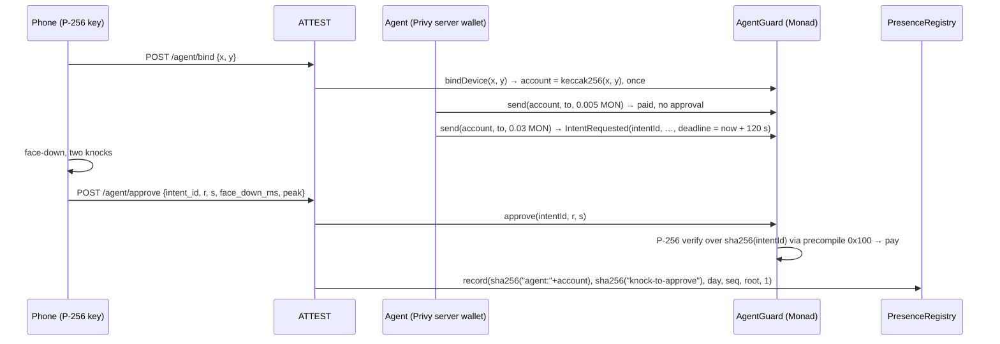

# Integration

PRESENCE records each verified session once in `PresenceRegistry` on Monad testnet (chain id 10143, RPC
`https://testnet-rpc.monad.xyz`, explorer `https://testnet.monadvision.com`). Reading it needs no SDK and no call to
our server.

| | |
|---|---|
| `PresenceRegistry` | `0x5519dacface816519ACa3ee3cD592fd4c61dE52B` |
| `AgentGuard` | `0xdC3Ba526FF565D0c76131D54a30aFA3c55041B11` |
| Attestor (writes records) | `0x5aB3036C7d0bA7043E0BB531374dC6c732eC4954` |

## Identities

The registry never stores an address. It is keyed by hashes:

```text
identity = sha256(identity_key)     identity_key = "dev:<wallet>" on the live server (development mode)
mission  = sha256(mission_id)       e.g. sha256("quick-noloss")
day      = unix_ts / 86400          UTC day number (int64)
```

Hash the exact string: `dev:` followed by the wallet address as the app sent it (case matters). Knock to Approve
records use `identity = sha256("agent:<account>")` and `mission = sha256("knock-to-approve")`.

## 1. From a contract (Solidity)

```solidity
interface IPresence {
    function isPresent(bytes32 identity, uint8 minAssurance, uint32 maxAgeDays) external view returns (bool);
    function presentDays(bytes32 identity, int64 fromDay, int64 toDay) external view returns (uint256);
    function today() external view returns (int64);
}

IPresence constant PRESENCE = IPresence(0x5519dacface816519ACa3ee3cD592fd4c61dE52B);

// a human verified present (assurance >= 2: FACEDOWN app session) today or yesterday (UTC)
require(PRESENCE.isPresent(id, 2, 1), "human presence required");

// the same human kept showing up: at least 3 distinct days in the last 30
int64 t = PRESENCE.today();
require(PRESENCE.presentDays(id, t - 29, t) >= 3, "not enough present days");
```

- `isPresent` checks the identity's **latest** record: its assurance must be ≥ `minAssurance` and its day within
  `maxAgeDays` of today.
- `presentDays` counts distinct UTC days in `[fromDay, toDay]` with at least one record.
- `profileOf(identity)` returns `{streak, bestStreak, lastDay, attestations, reputation, lastAssurance}`;
  `attestationOf(identity, mission, day, seq)` returns `{evidenceRoot, assurance, recordedAt, attestor}`.
- To trust only certain attestors, check `attestationOf(...).attestor`, or `isAttestor(addr)`.

Working examples in `contracts/src`: `HumanGatedVault` (an agent's large withdrawal needs `isPresent(owner, 2, 1)`)
and `SustainedHumanAirdrop` (pays only identities present on 3 of the last 30 days). Tests: `cd contracts && forge test`.

## 2. From a script or a frontend (viem)

```ts
import { createPublicClient, http, defineChain, parseAbi, sha256, stringToBytes } from "viem";

const monadTestnet = defineChain({
  id: 10143, name: "Monad Testnet",
  nativeCurrency: { name: "MON", symbol: "MON", decimals: 18 },
  rpcUrls: { default: { http: ["https://testnet-rpc.monad.xyz"] } },
});
const client = createPublicClient({ chain: monadTestnet, transport: http() });

const REGISTRY = "0x5519dacface816519ACa3ee3cD592fd4c61dE52B";
const abi = parseAbi([
  "function isPresent(bytes32 identity, uint8 minAssurance, uint32 maxAgeDays) view returns (bool)",
  "function presentDays(bytes32 identity, int64 fromDay, int64 toDay) view returns (uint256)",
  "function today() view returns (int64)",
]);

const identity = sha256(stringToBytes(`dev:${wallet}`));
const present = await client.readContract({ address: REGISTRY, abi, functionName: "isPresent", args: [identity, 2, 1] });
const today = await client.readContract({ address: REGISTRY, abi, functionName: "today" });
const days = await client.readContract({ address: REGISTRY, abi, functionName: "presentDays", args: [identity, today - 29n, today] });
if (present && days >= 3n) payWorker();
```

Every record also emits
`PresenceAttested(bytes32 indexed identity, bytes32 indexed mission, int64 day, uint8 seq, bytes32 evidenceRoot, uint8 assurance, uint32 streak, address attestor)`,
so an indexer can follow it with `getLogs`. The `/monad` page on the live server is a small browser verifier built
the same way (it reads the first registry, v1, and `HumanGatedVault`).

## 3. Knock to Approve for an AI agent (`AgentGuard`)

`AgentGuard` holds an agent's budget. The agent spends small amounts alone; above `limit` (0.01 MON in the deployed
instance) a transfer waits for the human's phone.



- **The contract.** `AgentGuard(agent, attestor, limit)`. `send` is callable only by `agent`; `approve` only by
  `attestor`, but `approve` checks the phone's signature itself, so the attestor can't approve anything the phone
  didn't sign. `intentId = keccak256(abi.encode(guard, chainid, account, to, amount, nonce))`; an intent executes
  once and expires after 120 s.
- **The phone.** Any phone browser: `crypto.subtle.generateKey({name: "ECDSA", namedCurve: "P-256"}, false, …)`, then
  `crypto.subtle.sign({name: "ECDSA", hash: "SHA-256"}, key, intentIdBytes)`, which is a signature over
  `sha256(intentId)`. Split the 64-byte result into `r` and `s`. The same curve as Android Keystore and passkeys.
- **The agent.** A Privy server wallet. Its Privy policy allows `eth_signTransaction` only when the transaction goes
  to `AgentGuard` on chain 10143; anything else is refused with `policy_violation` before it reaches the chain. Privy
  bounds where the agent can send; `AgentGuard` bounds how much it can send without its human. For local development
  ATTEST can use a plain key instead (`AGENT_KEY`).
- **Proof on testnet.** Bind, small send, held send, approval and presence record are listed with tx hashes in
  `contracts/deployments/monad-testnet.json` (`knockToApproveDemo`). `backend/scripts/knock_e2e.py` reproduces the flow
  against a running ATTEST, including a forged signature that the contract reverts.

ATTEST routes: `GET /agent` (the demo page), `GET /agent/config`, `POST /agent/bind {x, y}`,
`POST /agent/request {account, amount}` (demo amounts 0–0.05 MON, paid to the project treasury),
`GET /agent/intent/{id}`, `POST /agent/approve {intent_id, r, s, face_down_ms, peak, knocks}`.

## 4. Ask ATTEST (operational)

Live server: `https://presence-h7uy.onrender.com` (development mode, Monad testnet).

| Endpoint | Purpose |
|---|---|
| `GET /health` | mode (`development`/`production`), network, settlement adapter, physical rules enforced or reported, freeze price |
| `GET /missions` | public mission policies |
| `GET /profile/{wallet}` | XP, league, rank, streak, counters |
| `GET /session/{id}/receipt` | stored receipt, including the Monad tx and explorer link |
| `GET /sponsor/pools` | vault address and per-mission deposited / remaining / claims funded |
| `POST /sponsor/deposit {mission_id, signature}` | credit a mission pool with a confirmed `PresenceVault.fund()` transaction (`signature` = its tx hash) |
| `POST /missions/generate {prompt}` | draft a mission policy from plain language (for review) |
| `POST /session` → `/authorize` → `/checkpoint`×N → `/evidence` → `POST /verify` | the protocol (see [evidence-model.md](evidence-model.md)) |
| `GET /session/{id}/siwe`, `GET /metamask` | the SIWE message and stake transaction for a session; the MetaMask signing page |
| `POST /streak/freeze`, `POST /streak/freeze/{order_id}` | buy a streak freeze (0.02 MON, half burned) |
| `POST /dev/faucet {wallet}` | development only: 0.1 testnet MON once per wallet, for gas and a stake |

Errors are `{"error": REASON, "detail": "..."}` with reasons from `backend/attest/errors.py`.
